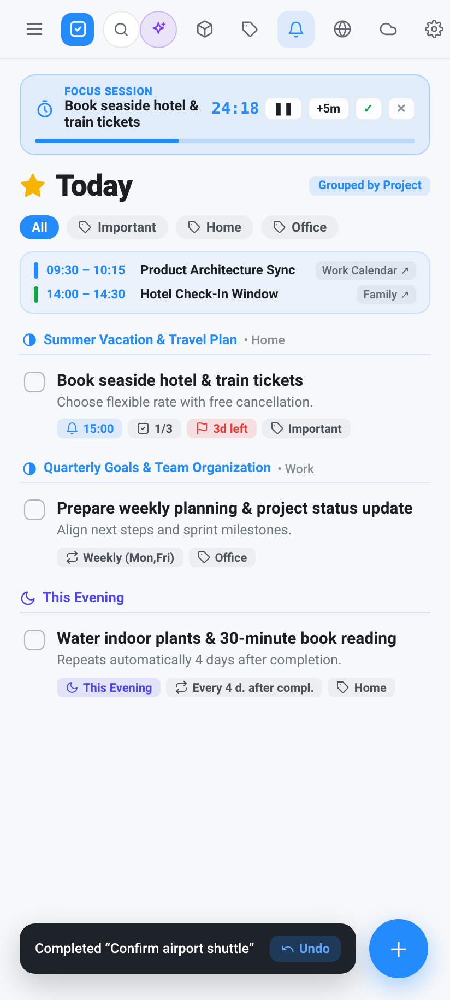
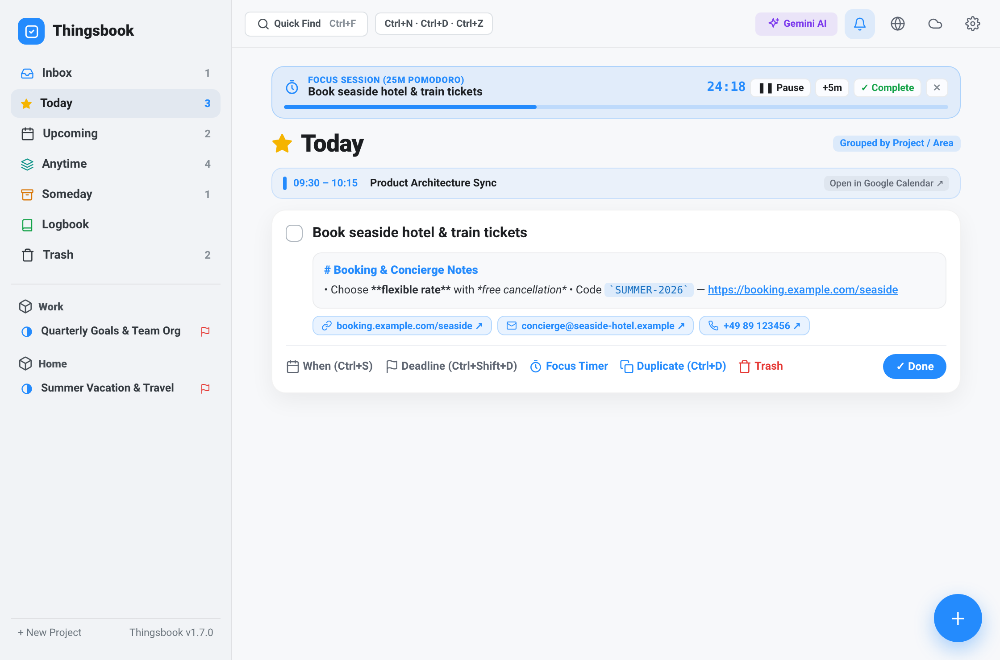
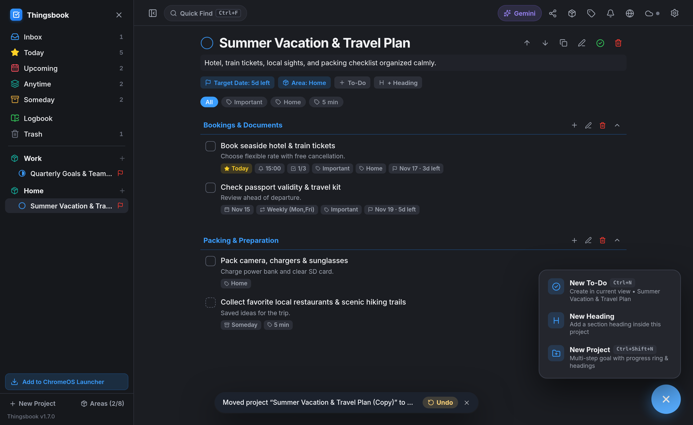
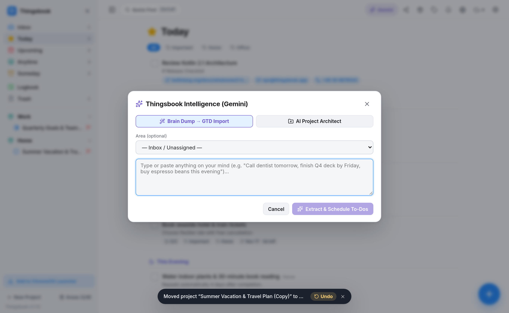

<div align="center">


# Thingsbook

**Native GTD Productivity Suite for Android, ChromeOS & macOS (`v2.0.1`, Build `72`)**

[-248BFD?style=flat-square)](https://github.com/petrosvassiliou/thingsbook-android/releases/tag/v2.0.1)
[](#1-thingsbook-for-android-native-apk--v201)
[](#2-thingsbook-for-chromeos-standalone-pwa--v200)
[](#3-thingsbook-for-macos-native-universal-app--v201)
[](#localization-5-languages)
[](#offline-first-storage-backups--cloud-sync)

[**📱 Download Android APK (v2.0.1)**](https://github.com/petrosvassiliou/thingsbook-android/releases/download/v2.0.1/Thingsbook-v2.0.1-GTD-Full.apk) · [**🍎 Download macOS Universal DMG (v2.0.1)**](https://github.com/petrosvassiliou/thingsbook-android/releases/download/v2.0.1/Thingsbook-macOS-v2.0.1-Universal.dmg) · [**💻 Launch ChromeOS / Web App**](https://thingsbook-prod.web.app) · [**📦 GitHub Releases**](https://github.com/petrosvassiliou/thingsbook-android/releases/latest) · [**🇩🇪 Deutsch**](#-deutsche-dokumentation)

</div>

---

## ⚠️ Independence Disclaimer / Unabhängigkeits-Erklärung

> **EN:** **Thingsbook** is an independent software project and is **in no way affiliated with, endorsed, or sponsored by Cultured Code GmbH & Co. KG** (the creators of *Things* / *Things 3*). Thingsbook operates **100% independently** and has **no data connection, interface, or compatibility with the official "Things Cloud" or any Cultured Code servers**. All data is stored strictly locally on your device (Room/SQLite on Android, IndexedDB on ChromeOS, SQLite3 + WAL on macOS) and optionally synced via this project's own independent Firebase Firestore backend.
>
> **DE:** Dieses Projekt ist eine komplett unabhängige Eigenentwicklung und steht in **keinerlei geschäftlicher, technischer oder rechtlicher Verbindung zur Cultured Code GmbH & Co. KG** (den Entwicklern von *Things* / *Things 3*). **Thingsbook funktioniert zu 100 % eigenständig** und besitzt **keinerlei Datenverbindung, Schnittstelle oder Kompatibilität zur offiziellen „Things Cloud“ oder sonstigen Servern von Cultured Code**. Alle Daten werden ausschließlich lokal auf dem jeweiligen Gerät (Android, ChromeOS, macOS) sowie optional im eigenen Firebase-Firestore-Backend des Projekts gespeichert.

---

## 🚀 What’s New in `v2.0.1` / `v2.0` (Build `72`) — Cross-Platform Release

1. **🧭 Guided 4-Step GTD Weekly Review & Cross-Device Review Sync (`Ctrl + Shift + R` / `⇧⌘R`)**
   - Interactive 4-step wizard across Android, ChromeOS, and macOS: **(1) Clear Inbox**, **(2) Today & Overdue Deadlines**, **(3) Projects Attention Audit**, and **(4) Someday & Weekly Wrap-Up**.
   - Automatically highlights open projects that have **zero open next-action tasks** or haven't been reviewed in **14+ days** — with inline **"Add next action…"**, **"Mark Reviewed ✓"** (`lastReviewedAt` synced monotonically across devices), and **"Move to Someday"**.
2. **📋 Reusable Project Templates & 1-Click Markdown / JSON Outline Importer**
   - Save any active project (headings, open tasks, checklists, tags, durations, and relative schedule offsets) as a reusable **`ProjectTemplate`** synced via Firestore and included inside encrypted `.tbbackup` archives.
   - Includes **4 localized Starter GTD Templates** (*Trip & Packing*, *Product Launch*, *Client Onboarding*, *Weekly Sprint*) across `EN`, `DE`, `FR`, `IT`, and `ES`.
   - Paste structured Markdown (`# Project`, `## Heading`, `- [ ] Task`, indented `- [ ] Subtask`) or JSON blueprints to generate complete GTD projects in one click.
3. **⏱️ Interactive Timeblocking, Daily Timeline & Quiet Subordinate Calendar Appointments**
   - Assign start times (`scheduledStartMinutes`) and durations (`15m`–`2h`) to tasks with automatic Focus Timer duration matching.
   - Toggle **Today** between **`📋 List`** and **`🗓️ Timeline`** to view an interleaved chronological schedule of Calendar Events and Timeblocked Tasks, complete with overlap conflict indicators, `+15m` quick nudges, and an **Unscheduled Today** tray.
   - Past appointments automatically clear from *Today* and *Upcoming*, while active/upcoming calendar events render inside a compact, subordinate grouped container so visual focus stays squarely on your tasks.
4. **⚡ Instant Pull-Before-Push Cloud Sync & Deterministic Recurring Task Deduplication**
   - Sub-second multi-device wake notifications via `SHA-256` UID `ntfy` wake topics, per-collection Firestore delta cursors, automatic parent project/area self-healing, and `120s` clock-skew protection (`100%` forward & backward compatible with `v1.8.x`).
   - Deterministic cross-platform recurring task UUID generation and non-poisoning midnight rollover eliminate duplicate recurring instances across synced devices.
5. **✨ Desktop & Mobile UX Polish Across All Platforms (`v2.0.1` Update)**
   - **Android "Planned" (`Upcoming` / *"Geplant"*) Scroll Fix (`v2.0.1`):** Opening the Planned smart view now cleanly anchors at the very top (`index 0`) displaying the earliest scheduled task instead of cross-anchoring to the bottom of the list.
   - **Project Deletion Choice + Undo:** Choose between cascade-deleting a project's tasks or detaching & keeping them in the parent Area, with full 5-second **Undo** and Trash restoration.
   - **macOS Zero-DMG In-App Auto-Updater:** One-click **Settings → Updates → Install & Relaunch** on macOS, plus native AppKit/SwiftUI icon+label Settings toolbar.
   - **Refined Task Cards, Draggable Magic Plus (`+`) & Instant Tooltips:** Opening an existing task card preserves cursor focus without selecting all text, *Today* cards feature a 1-click **`🌙 This Evening`** pill, draggable Magic Plus (`+`) drops directly into To-Do slots or Project Headings, and top-bar icon buttons feature centered `160ms` cold / `0ms` warm-handoff localized tooltips.

---

# 1. Thingsbook for Android (Native APK — `v2.0.1`)

**Thingsbook for Android** (`app/`) is a 100% native GTD (*Getting Things Done*) productivity app built from scratch for **Android smartphones, tablets, and foldables** using **Kotlin**, **Jetpack Compose (Material 3)**, and an **offline-first Room + SQLite FTS5 (`unicode61`) database**.

### 📥 Direct Android Download (`v2.0.1`, Build `72`)
- **[Download `Thingsbook-v2.0.1-GTD-Full.apk`](https://github.com/petrosvassiliou/thingsbook-android/releases/download/v2.0.1/Thingsbook-v2.0.1-GTD-Full.apk)**
- **[Download `Thingsbook-Full-GTD-Edition.apk`](https://github.com/petrosvassiliou/thingsbook-android/releases/download/v2.0.1/Thingsbook-Full-GTD-Edition.apk)**

---

### 📸 Android Screenshots

#### Android Smartphones (`< 700dp` — Focus Timer, Google Calendar, Markdown Notes & Dark Mode)

<div align="center">
<table>
  <tr>
    <td align="center"><b>Today: Focus Timer, Calendar, Project Grouping &amp; Undo</b></td>
    <td align="center"><b>Inline Card: Live Markdown Notes &amp; Link Chips</b></td>
    <td align="center"><b>Project &amp; Headings (Dark): Duplicate &amp; Links</b></td>
  </tr>
  <tr>
    <td></td>
    <td></td>
    <td></td>
  </tr>
</table>
</div>

#### Android GTD Power Pack — Quick Share Sheet, Trash & Undo, Calendar & Security Settings

<div align="center">
<table>
  <tr>
    <td align="center"><b>&ldquo;Share to Thingsbook&rdquo; Quick Entry Sheet</b></td>
    <td align="center"><b>Trash / Recently Deleted &amp; 5s Undo Bar</b></td>
    <td align="center"><b>Settings: Calendar, Grouping &amp; Biometric Lock</b></td>
  </tr>
  <tr>
    <td></td>
    <td></td>
    <td></td>
  </tr>
</table>
</div>

#### Android Tablets & Unfolded Foldables (`>= 700dp` — Persistent 2-Column Workspace)



---

### ✨ Native Android Highlights (`v1.7` – `v2.0`)

1. **⚡ Android System Quick Settings Tile (`TileService`) & Launcher App Shortcuts**
   - Add the **Thingsbook — New To-Do** tile to your Android Quick Settings shade or long-press the home screen icon for 1-tap **New To-Do**, **Voice Capture**, **Today**, **Inbox**, and **Quick Find**.
2. **🎙️ Voice-to-Task Dictation & 1-Tap "✨ Smart Parse with Gemini"**
   - Dictate tasks hands-free via Android `RecognizerIntent` from the top bar, Quick Capture sheet, or Home Screen Widgets, and split spoken brain dumps into scheduled GTD tasks, tags, and checklists with Gemini.
3. **📱 Home Screen Widgets (`4×1` Quick Capture Bar + `4×2` GTD List with Project Mode)**
   - **Quick Capture Bar (`4×1`):** One-tap **Today**, **🔍 Quick Find**, **🎙️ Voice Capture**, and **+ New To-Do** pill bar.
   - **Main GTD List (`4×2`):** Switch between *Today*, *Inbox*, *Upcoming*, and **🎯 Project** directly on your home screen.
4. **📎 Rich Task & Project Attachments (Camera, Photos, PDFs & Files)**
   - Attach photos (`📷 Take Photo` / `🖼️ Choose Image`), PDFs, or documents (`📄 Choose File / PDF`) with automatic JPEG compression, **`📎 N` count badges**, horizontal thumbnail strips, and an in-app **zoomable Image & native `PdfRenderer` PDF viewer** + OS Share.
5. **📍 Location & Google Maps Chips + Live Markdown Notes**
   - Real-time Markdown formatting (`# Headings`, `**bold**`, `*italic*`, `` `code` ``, `- ` lists) plus one-tap **Web**, **Email (`mailto:`)**, **Phone (`tel:`)**, and **Google Maps (`📍`)** chips.
6. **📤 "Share to Thingsbook" (`ACTION_SEND`), 🔔 Actionable Notifications, ⏱️ 25m Focus Timer & 🔒 Biometric App Lock**
   - Share links or text from any Android app directly into any Smart View, Project, or Area; complete or snooze (`+1h` / `Tomorrow`) tasks right from notifications; run Pomodoro sessions synced with an ongoing notification; and protect your workspace with `BiometricPrompt` / device PIN.

### 🏗️ Core Native Android Architecture & GTD Features

- **Adaptive Layout for Phones (`< 700dp`), Tablets & Foldables (`>= 700dp`):** Thumb-friendly drawer, fluid 120 Hz spring card expansion, and draggable **Magic Plus (`+`)** FAB on phones; persistent 2-column master-detail workspace with live pie-chart progress rings and hardware keyboard shortcuts on tablets and foldables.
- **Complete GTD Hierarchy:** *Inbox*, *Today* (with **🌙 This Evening** & **🗓️ Daily Timeline**), *Upcoming*, *Anytime*, *Someday*, *Logbook*, and *Trash* — plus **Areas** (up to 8), **Projects** (with progress rings, deadlines `🏁`, & reusable **Templates**), collapsible **Headings**, reorderable **Checklists**, **Timeblocks**, flexible **Recurrence Rules**, hierarchical **Tags**, and LexoRank `sortOrder`.
- <a id="offline-first-storage-backups--cloud-sync"></a>**Offline-First Room/SQLite FTS5 + Encrypted `.tbbackup` + Cloud Sync:**
  - **Room + SQLite FTS5 (`unicode61 remove_diacritics 2`):** Sub-millisecond full-text search across titles, notes, projects, tags, and checklists — works 100% offline, with an optional strict **Local-Only Mode**.
  - **Encrypted `.tbbackup` Backup & Restore:** Atomic single-file archive of all entities, templates, attachments & preferences — plain or encrypted with **AES-256-GCM** & **PBKDF2-HMAC-SHA256 (`120,000` iterations)** — plus CSV & Markdown/JSON outline import/export.
  - **Optional Bidirectional Firebase Delta Sync:** Real-time multi-device sync via Firebase Auth (Email/Password & Google Sign-In) + Firestore delta queries + instant `ntfy` UID wake notifications.
- **4 Multilingual Gemini AI Features (Optional — Bring Your Own Key):** **✨ Magic Breakdown**, **🧠 Brain Dump → GTD Import**, **📐 AI Project Architect**, and **📖 Logbook AI Reflection**.
- <a id="localization-5-languages"></a>**Full 5-Language Localization (`DE`, `EN`, `FR`, `IT`, `ES`):** `517` verified localization keys per language, instant in-app language switcher, and a 5-language natural language date & time parser.

### 🛠️ Build Android APK Locally
```bash
./gradlew assembleRelease
```

---

# 2. Thingsbook for ChromeOS (Standalone PWA — `v2.0.0`)

Alongside the native Android APK, this repository includes a dedicated **ChromeOS Standalone PWA** (`chromeos-pwa/`) engineered specifically for Chromebooks and desktop browsers — with **100% `v2.0.0` feature, sync, and `.tbbackup` parity** — without requiring the Linux container (Crostini) or Android VM (ARCVM).

### 🚀 Launch & Install on ChromeOS
- **Live App URL:** **[https://thingsbook-prod.web.app](https://thingsbook-prod.web.app)** *(hosted on Firebase Hosting)*
- **Pin to ChromeOS Start Menu (Launcher) & Shelf:**
  1. Open **`https://thingsbook-prod.web.app`** in Chrome on your Chromebook.
  2. Click **"Add to ChromeOS Launcher"** in the bottom-left sidebar (or the **Install `⊕` icon** in the Chrome address bar).
  3. Thingsbook installs as a standalone Chromebook application in your **Start Menu (Launcher)** and **Shelf**, opens in its own frameless window, registers as a **ChromeOS Share Target** + **Launcher Shortcut** provider (*New To-Do*, *Voice Capture*, *Today*, *Inbox*, *Upcoming*, *Quick Find*), and runs **100% offline** via IndexedDB + Service Worker.

### ✨ ChromeOS `v2.0.0` Feature Parity
- **🧭 Guided 4-Step GTD Weekly Review (`Ctrl + Shift + R`), 📋 Project Templates & Markdown Outline Importer, and 🗓️ Today Timeblocking Timeline.**
- **🎙️ Voice-to-Task Dictation & "✨ Smart Parse with Gemini":** Dictate tasks via the Web Speech API and parse multi-task spoken brain dumps in one click.
- **📎 Drag-and-Drop & File Picker Attachments (`IndexedDB` + `.tbbackup` + Cloud Sync):** Attach images, PDFs, or files to any Task or Project with automatic Canvas JPEG compression, **`📎 N` badges**, and an in-app **zoomable Image & PDF preview modal**.
- **📍 Location & Google Maps Chips + 📝 Live Markdown Notes:** Clickable **Web**, **Email**, **Phone**, and **Google Maps (`📍`)** chips on tasks and projects.
- **⏱️ 25m Focus / Pomodoro Timer, 🗑️ Trash View (`Ctrl + 7`) & 5s Undo (`Ctrl + Z`), 📋 Duplicate To-Do / Project (`Ctrl + D`), 🔔 Actionable Service Worker Notifications, 📅 Google Calendar / `.ics` Agenda, and 🔒 Chromebook Fingerprint (WebAuthn) / PIN App Lock.**

---

### 📸 ChromeOS Screenshots

#### Chromebook Light Mode — *Today* Grouped by Project/Area, 25m Focus Timer, Link Chips & *Trash*


#### Chromebook Dark Mode — Project Progress Ring, Collapsible Headings, Duplicate Project & *Magic Plus* (`Ctrl+N` / `Ctrl+Shift+N`)


#### Chromebook *Thingsbook Intelligence* — Multilingual Gemini AI Hub


---

### ⌨️ Hardware Keyboard Shortcuts (Android Foldables/Tablets, ChromeOS & macOS)

| Shortcut | Action |
| :--- | :--- |
| `Ctrl + N` / `⌘N` | **New To-Do** in the active view (works globally) |
| `Ctrl + Shift + N` / `⇧⌘N` | **New Project** modal (pre-selects active Area) |
| `Ctrl + Shift + R` / `⇧⌘R` | Open **Guided 4-Step GTD Weekly Review** |
| `Ctrl + D` / `⌘D` | **Duplicate** expanded To-Do or current Project |
| `Ctrl + Z` / `⌘Z` | **Undo** the last task completion or deletion |
| `Ctrl + S` / `⌘S` | Open **When / Schedule** picker for expanded To-Do |
| `Ctrl + Shift + D` / `⇧⌘D` | Open **Deadline** picker for expanded To-Do |
| `Ctrl + Shift + M` / `⇧⌘M` | Open **Move to Project / Area** picker |
| `Ctrl + Backspace` / `⌘⌫` | Move expanded or selected To-Do(s) to **Trash** |
| `Ctrl + F` / `⌘F` or `Ctrl + K` / `⌘K` | Toggle **Quick Find** instant search (with scope & tag/date filters) |
| `Ctrl + G` / `⌘G` | Open **Thingsbook Intelligence (Gemini AI Hub)** |
| `Ctrl + 1` … `Ctrl + 7` / `⌘1` … `⌘7` | Jump to *Inbox*, *Today*, *Upcoming*, *Anytime*, *Someday*, *Logbook*, or *Trash* |
| `Ctrl + A` / `⌘A` | Select all visible To-Dos in the current view for batch actions |
| `Double-Click` / `Enter` | Expand or collapse a To-Do card inline |
| `Esc` | Close active popover, modal, Quick Find, expanded card, or selection |

### 🛠️ Build & Deploy ChromeOS PWA
```bash
cd chromeos-pwa
npm ci
npm test
npm run lint
npm run build
```

---

# 3. Thingsbook for macOS (Native Universal App — `v2.0.1`)

**Thingsbook for macOS** (`macos/`) is a **100% native Swift + SwiftUI + AppKit desktop application** for **macOS 14+ (Sonoma, Sequoia & Tahoe)** running natively on both **Apple Silicon (`arm64`) and Intel (`x86_64`)** Macs, engineered in strict feature, localization, SQLite FTS5, `.tbbackup`, and Firestore sync parity with Android and ChromeOS (`v2.0.1`, Build `72`).

### 📥 Install or Upgrade on macOS (`v1.7.0 / v1.8.x / v2.0.0 → v2.0.1`)
- **Direct Universal DMG Download:** **[Download `Thingsbook-macOS-v2.0.1-Universal.dmg`](https://github.com/petrosvassiliou/thingsbook-android/releases/download/v2.0.1/Thingsbook-macOS-v2.0.1-Universal.dmg)**
- **In-App 1-Click Updater:** Open **Settings (`⌘,`) → Updates → Install & Relaunch** to download, verify, atomically swap `/Applications/Thingsbook.app`, and relaunch without touching a `.dmg`.
- **Instant 1-Command Terminal Install / Upgrade (No Gatekeeper Prompts):**
  ```bash
  curl -fsSL https://raw.githubusercontent.com/petrosvassiliou/thingsbook-android/main/macos/install.sh | bash
  ```
  *(Automatically quits a running instance if open, installs `v2.0.1` into `/Applications/Thingsbook.app`, and preserves your SQLite database, attachments, Keychain sync credentials, and preferences.)*

### ✨ Native macOS Highlights (`v2.0.1`, Build `72`)
1. **🧭 Weekly Review (`⇧⌘R`), 📋 Synced Project Templates & Markdown Importer, and 🗓️ Today Timeblocking Timeline**
   - Native SwiftUI/AppKit implementations of the 4-step Weekly Review wizard, Template Gallery & Markdown/JSON outline importer, Today List/Timeline toggle, and quiet compact Apple Calendar (`EventKit`) appointment rows.
2. **🎙️ Native macOS Voice Dictation (`SFSpeechRecognizer` + `AVAudioEngine`) & "✨ Smart Parse with Gemini"**
   - Dictate tasks live from the toolbar **`🎙️` Voice** button, **Quick Entry (`⌃⇧⌘V`)**, **Magic Plus (`+`)**, **Dock Menu**, **`thingsbook://voice`** URL scheme, or inline on any expanded task card.
3. **🎯 Menu Bar Extra (`MenuBarExtra`) & Global Quick Entry**
   - Switch between **Today** and **🎯 Project** right inside the macOS status bar popover with quick task completion, Quick Capture, and Voice Capture.
4. **📎 Native Task & Project Attachments (`PDFKit` + Zoomable Image Viewer) & 📍 Apple Maps Chips**
   - Drag and drop files from Finder onto any task card, view multi-page PDFs natively via `PDFKit`, and click detected addresses/coordinates to open them directly in **Apple Maps**.
5. **🔄 Zero-DMG In-App Auto-Updater, Native Settings Toolbar & 100% 5-Language Parity**
   - Native AppKit/SwiftUI icon+label Settings window, centered instant warm-handoff top-bar tooltips, 1-click flag language switcher (`EN`, `DE`, `FR`, `IT`, `ES`), Touch ID app lock, and CI parity verification via `macos/scripts/verify-android-parity.py`.

---

### 🔄 Seamless Cross-Platform Interoperability & `v1.7 / v1.8 / v2.0.0 → v2.0.1` Upgrade
- **100% Zero-Data-Loss In-Place Upgrades:**
  - **Android:** Signed with the identical X.509 release certificate (`versionCode 41 / 44 / 71 → 72`) and automatic Room migrations (`MIGRATION_2_3`, `MIGRATION_3_4`).
  - **ChromeOS:** Automatic additive IndexedDB migrations (`DB_VERSION 1 → 3`) and Service Worker `autoUpdate`.
  - **macOS:** Automatic additive SQLite3 schema migrations, backward-compatible `AppPreferences` & Keychain session preservation, and 1-click in-app updates.
- **Real-Time Multi-Device Delta Sync:** Sign in with the same Email/Password or Google account on Android, ChromeOS, and macOS to sync *Areas*, *Projects*, *Headings*, *Tasks*, *Checklists*, *Tags*, *Attachments*, and *Project Templates* in real time via Firestore + instant `ntfy` wake notifications.
- **Identical `.tbbackup` Binary Format:** Export an AES-256-GCM encrypted `.tbbackup` file on Android, ChromeOS, or macOS and restore it on any of the three platforms (`v1.7.x` and `v1.8.x` backups restore cleanly into `v2.0.x`).

---

## 🇩🇪 Deutsche Dokumentation

### 1. Thingsbook für Android (Native Android-App — `v2.0.1`, Build `72`)
Eine eigenständige, native Android-Produktivitäts-App für **Android-Smartphones, Tablets & Foldables**, entwickelt mit **100 % Kotlin**, **Jetpack Compose**, **Offline-First Room Database (SQLite FTS5 `unicode61`)**, **AES-256-GCM `.tbbackup` Komplett-Backup**, optionalem **Firebase Firestore Echtzeit-Delta-Sync**, **4 Gemini-KI-Funktionen** und **5 Sprachen (`DE`, `EN`, `FR`, `IT`, `ES`)**. Nahtlos aktualisierbar von `v1.7.0`, `v1.8.x` und `v2.0.0`.
- **📱 Direkt-Download Android-APK (`v2.0.1`):** **[Thingsbook-v2.0.1-GTD-Full.apk herunterladen](https://github.com/petrosvassiliou/thingsbook-android/releases/download/v2.0.1/Thingsbook-v2.0.1-GTD-Full.apk)**

#### ✨ Highlights in `v2.0.1` / `v2.0`:
- **🧭 Geführter 4-Schritte-GTD-Wochenrückblick (`Strg + Umschalt + R`):** Interaktiver Assistent für *Eingang leeren*, *Heute & überfällige Fristen*, *Projekt-Aufmerksamkeitsprüfung (14-Tage-Check mit Geräte-Sync)* und *Irgendwann / Abschluss*.
- **📋 Wiederverwendbare Projekt-Vorlagen & Markdown-/JSON-Gliederungs-Import:** Beliebige Projekte inkl. Überschriften, Aufgaben, Checklisten & Tags als synchronisierte Vorlage speichern, 4 lokalisierte Starter-Vorlagen nutzen oder `# Projekt` / `## Überschrift` / `- [ ] Aufgabe`-Markdown direkt importieren.
- **⏱️ Zeitblöcke (`Timeblocking`), Tages-Zeitachse (`📋 Liste ↔ 🗓️ Zeitachse`) & dezente Kalendertermine:** Startzeit & Dauer pro Aufgabe planen, Konflikte erkennen, vergangene Termine automatisch ausblenden und aktive Kalendertermine kompakt und untergeordnet darstellen.
- **⚡ Sofortiger Echtzeit-Cloud-Sync (`ntfy` UID-Wake-Relay), duplikatfreie wiederkehrende Aufgaben & „Geplant“-Scroll-Fix (`v2.0.1`).**
- **🎙️ Spracheingabe & „✨ Mit Gemini aufteilen“, 📎 Foto-/PDF-/Datei-Anhänge mit Zoom- & PDF-Viewer, 📍 Google-Maps-Chips, 📱 `4×1`- & `4×2`-Widgets, ⚡ Schnelleinstellungs-Kachel, ⏱️ 25-Min.-Fokus-Timer, 🗑️ Papierkorb & 5s-„Rückgängig“ sowie 🔒 Biometrie-Sperre.**

### 2. Thingsbook für ChromeOS (Eigenständige Standalone-PWA — `v2.0.1`)
`chromeos-pwa/` enthält das eigenständige **ChromeOS-Paket mit voller `v2.0`-Funktionsparität** (*4-Schritte-Wochenrückblick*, *Projekt-Vorlagen & Markdown-Importer*, *Tages-Zeitplanung & kompakte Kalendertermine*, *Spracheingabe & Gemini Smart Parse*, *Drag-&-Drop-Datei-/Foto-/PDF-Anhänge mit Vorschau*, *Google-Maps-Orts-Chips*, *Web Share Target*, *25-Min.-Fokus-Timer*, *Live-Markdown*, *Papierkorb & Rückgängig* sowie *WebAuthn-Fingerabdruck-/PIN-Sperre*) — gehostet auf **Firebase Hosting** und **ohne Linux-Container (Crostini)** direkt im **ChromeOS-Startmenü (Launcher) & Shelf** installierbar:
- **💻 Live-App für Chromebooks:** **[https://thingsbook-prod.web.app](https://thingsbook-prod.web.app)** *(in Chrome öffnen → „Zum ChromeOS-Launcher hinzufügen“ klicken → aktualisiert sich automatisch auf `v2.0.1`, 100 % offline-fähig via IndexedDB + Service Worker).*

### 3. Thingsbook für macOS (Native Universal-App — `v2.0.1`, Build `72`)
`macos/` enthält die **100 % native Swift/SwiftUI/AppKit-Desktop-App für macOS 14+ (Apple Silicon & Intel)** mit voller `v2.0`-Parität (*In-App-Auto-Updater ohne DMG-Handling*, *4-Schritte-Wochenrückblick `⇧⌘R`*, *Projekt-Vorlagen*, *Tages-Zeitachse & kompakte Apple-Kalender-Termine*, *Live-Sprachdiktat `⌃⇧⌘V` & Gemini Smart Parse*, *Menüleisten-App mit Heute/Projekt-Modus*, *Drag-&-Drop-Anhänge inkl. nativem `PDFKit`-Viewer*, *Apple-Maps-Orts-Chips*, *Touch ID*, *SQLite FTS5*, *`.tbbackup`* und *Firestore Cloud-Sync*):
- **🍎 Direkt-Download Universal-DMG (`v2.0.1`):** **[Thingsbook-macOS-v2.0.1-Universal.dmg herunterladen](https://github.com/petrosvassiliou/thingsbook-android/releases/download/v2.0.1/Thingsbook-macOS-v2.0.1-Universal.dmg)**
- **⚡ 1-Befehl-Installation / Upgrade im Terminal:**
  ```bash
  curl -fsSL https://raw.githubusercontent.com/petrosvassiliou/thingsbook-android/main/macos/install.sh | bash
  ```

---

## 📂 Repository Structure

```text
thingsbook-android/
├── app/                     # 1. Native Android APK (Kotlin, Jetpack Compose, Room + SQLite FTS5)
├── chromeos-pwa/            # 2. Standalone ChromeOS PWA (TypeScript, React, IndexedDB + Workbox)
├── macos/                   # 3. Native macOS Universal App (Swift, SwiftUI, AppKit, SQLite3 FTS5 + PDFKit)
├── docs/screenshots/        # Retina UI screenshots (Android Phone, Android Tablet & ChromeOS)
├── releases/                # Release notes & signed release archives
├── firebase.json            # Firebase Hosting & Firestore configuration
├── firestore.rules          # Per-user Firestore security rules
└── deploy-chromeos-pwa.sh   # One-step ChromeOS PWA build & Firebase Hosting deploy script
```
