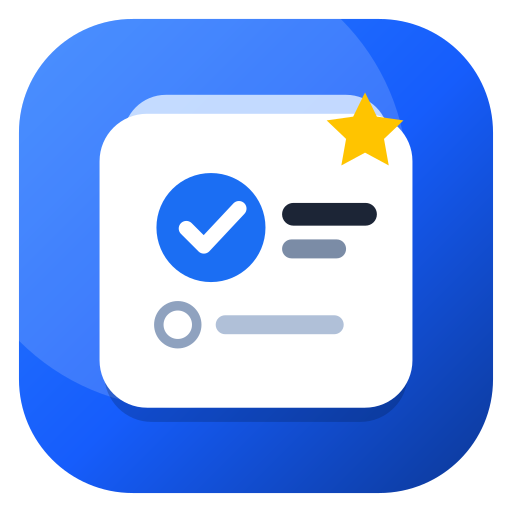
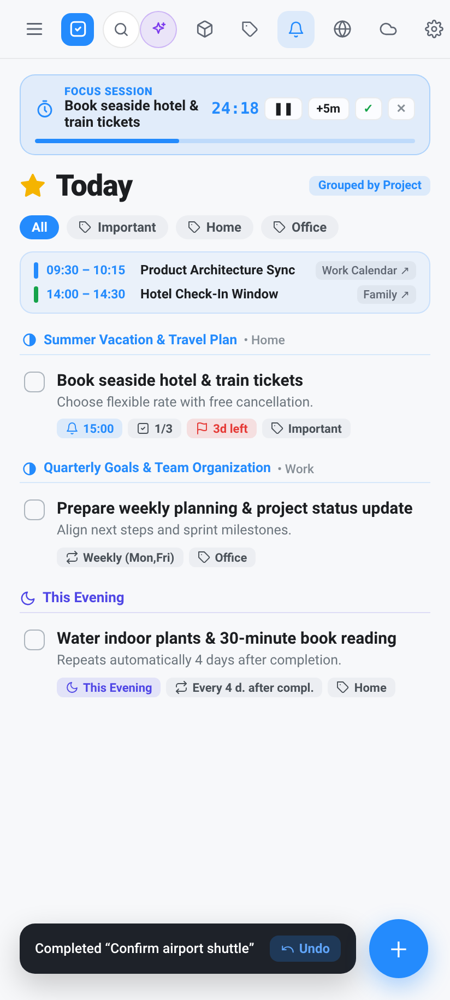
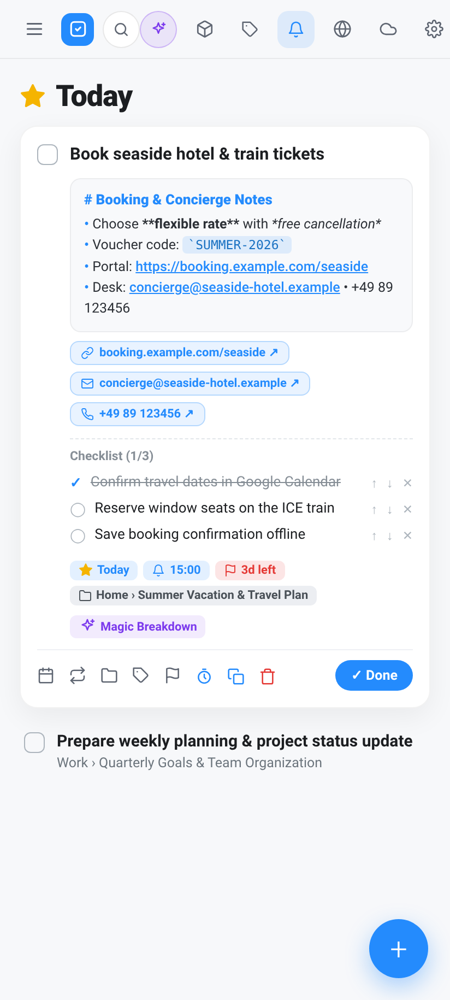
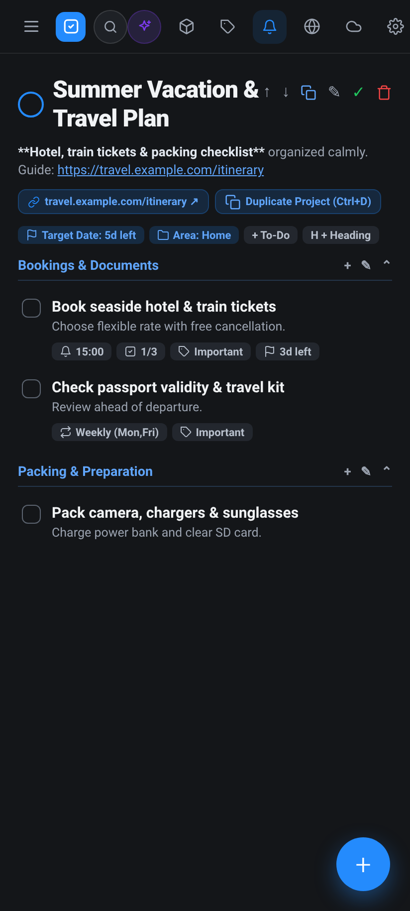
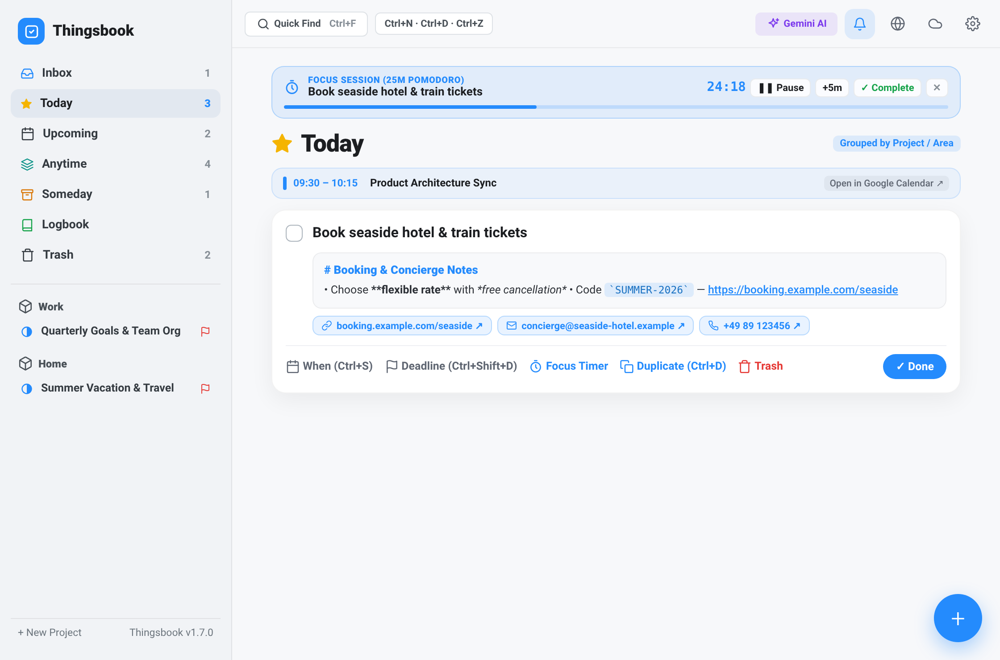
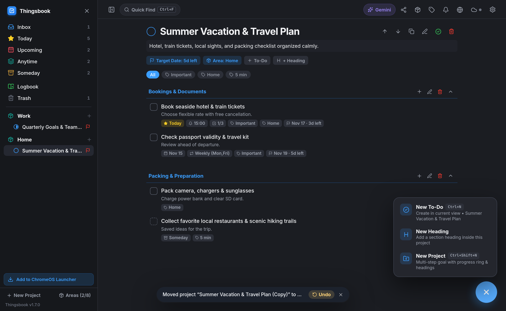
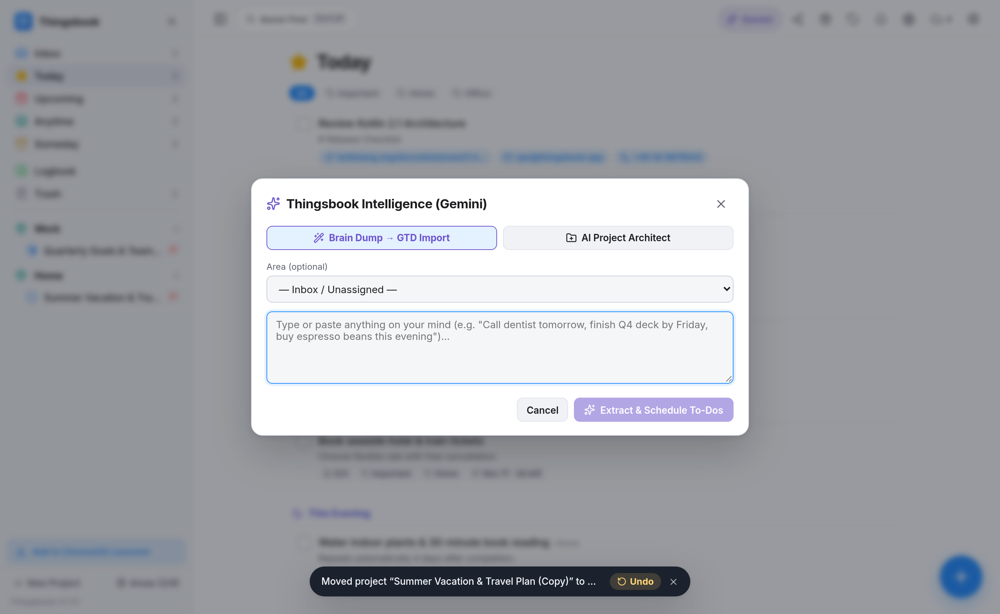

<div align="center">



# Thingsbook

**Native Android GTD Productivity App — with Companion Standalone App for ChromeOS**

[](https://github.com/petrosvassiliou/thingsbook-android)
[](#1-thingsbook-for-android-native-apk)
[](#2-thingsbook-for-chromeos-standalone-pwa)
[](#localization-5-languages)
[](#offline-first-storage-backups--cloud-sync)

[**📱 Download Android APK (v1.6.21)**](https://github.com/petrosvassiliou/thingsbook-android/raw/main/Thingsbook-v1.6.21-full.apk) · [**🤖 Android Overview & Screenshots**](#1-thingsbook-for-android-native-apk) · [**💻 ChromeOS Version & Screenshots**](#2-thingsbook-for-chromeos-standalone-pwa) · [**🇩🇪 Deutsch**](#-deutsche-dokumentation)

</div>

---

## ⚠️ Independence Disclaimer / Unabhängigkeits-Erklärung

> **EN:** **Thingsbook** is an independent software project and is **in no way affiliated with, endorsed, or sponsored by Cultured Code GmbH & Co. KG** (the creators of *Things* / *Things 3*). Thingsbook operates **100% independently** and has **no data connection, interface, or compatibility with the official "Things Cloud" or any Cultured Code servers**. All data is stored strictly locally on your device (Room/SQLite on Android, IndexedDB on ChromeOS) and optionally synced via this project's own independent Firebase Firestore backend.
>
> **DE:** Dieses Projekt ist eine komplett unabhängige Eigenentwicklung und steht in **keinerlei geschäftlicher, technischer oder rechtlicher Verbindung zur Cultured Code GmbH & Co. KG** (den Entwicklern von *Things* / *Things 3*). **Thingsbook funktioniert zu 100 % eigenständig** und besitzt **keinerlei Datenverbindung, Schnittstelle oder Kompatibilität zur offiziellen „Things Cloud“ oder sonstigen Servern von Cultured Code**. Alle Daten werden ausschließlich lokal auf dem jeweiligen Gerät sowie optional im eigenen Firebase-Firestore-Backend des Projekts gespeichert.

---

# 1. Thingsbook for Android (Native APK)

**Thingsbook for Android** (`app/`) is a 100% native GTD (*Getting Things Done*) productivity app built from scratch for **Android smartphones, tablets, and foldables** using **Kotlin**, **Jetpack Compose (Material 3)**, and an **offline-first Room + SQLite FTS5 (`unicode61`) database**.

### 📥 Direct Android Download (`v1.6.21`, Build `38`)
- **[Download `Thingsbook-v1.6.21-full.apk`](https://github.com/petrosvassiliou/thingsbook-android/raw/main/Thingsbook-v1.6.21-full.apk)**

---

### 📸 Android Screenshots

#### Android Smartphones (`< 700dp` — Single-Handed Layout, 120 Hz Inline Expansion & Dark Mode)

<div align="center">
<table>
  <tr>
    <td align="center"><b>Today &amp; This Evening</b></td>
    <td align="center"><b>Inline Card &amp; Checklists</b></td>
    <td align="center"><b>Project &amp; Headings (Dark)</b></td>
  </tr>
  <tr>
    <td></td>
    <td></td>
    <td></td>
  </tr>
</table>
</div>

#### Android Tablets & Unfolded Foldables (`>= 700dp` — Persistent 2-Column Workspace)



---

### ✨ Native Android Architecture & GTD Features

- **Adaptive Layout for Phones, Tablets & Foldables (`700dp` Breakpoint)**
  - **Smartphones (`< 700dp`):** Thumb-friendly navigation drawer, swipe-down *Quick Find*, fluid 120 Hz spring card expansion (`spring(dampingRatio = 0.8f, stiffness = 400f)`), and draggable **Magic Plus (`+`)** Floating Action Button for direct drag-and-drop creation into lists.
  - **Tablets & Foldables (`>= 700dp`):** 2-column master-detail workspace with persistent sidebar, live Smart View badges, live pie-chart project progress rings, centered reading canvas (`max 840dp`), and hardware keyboard support.
- **Complete GTD Hierarchy**
  - **Smart Views:** *Inbox*, *Today* (with a separate **🌙 This Evening** section), *Upcoming* (grouped day-by-day timeline), *Anytime*, *Someday*, and *Logbook*.
  - **Areas, Projects & Headings:** Group responsibilities into **Areas**, track multi-step **Projects** with live pie-chart **Progress Rings** and target dates (`🏁`), and structure projects with collapsible **Headings**.
  - **Rich To-Dos:** Reorderable **Checklists**, **Natural Language Date Input** (*"tomorrow"*, *"next fri"*, *"in 3 days"*), flexible **Recurrence Rules** (*fixed schedule* or *X days/weeks/months after completion*), exact alarm notifications & daily morning digest, hierarchical **Tags**, LexoRank `sortOrder`, and long-press on the checkbox to mark **Canceled (`✕`)**.
- <a id="offline-first-storage-backups--cloud-sync"></a>**Offline-First Room/SQLite FTS5 + Encrypted `.tbbackup` + Cloud Sync**
  - **Room + SQLite FTS5 (`unicode61 remove_diacritics 2`):** Instant sub-millisecond full-text search across titles, notes, projects, and checklist items — works 100% offline, including an optional strict **Local-Only Mode**.
  - **Encrypted `.tbbackup` Backup & Restore:** Single-file atomic backup of all entities & preferences — plain or password-encrypted with **AES-256-GCM** & **PBKDF2-HMAC-SHA256 (`120,000` iterations)** — plus CSV import/export.
  - **Optional Bidirectional Firebase Delta Sync:** Multi-device account sync via Firebase Auth + Firestore (`whereGreaterThan("updatedAt", lastSyncTimestamp)`, batched writes, Last-Write-Wins conflict resolution, and soft-delete tombstones).
- **4 Multilingual Gemini AI Features (Optional — Bring Your Own Key)**
  1. **✨ Magic Breakdown:** Breaks complex tasks into 4–7 concrete checklist steps in one tap.
  2. **🧠 Brain Dump → GTD Import:** Parses unstructured thoughts into scheduled tasks with dates, deadlines, tags, and checklists.
  3. **📐 AI Project Architect:** Designs a complete project with phases (*Headings*) and actionable *To-Dos* from a goal description.
  4. **📖 Logbook AI Reflection:** Summarizes completed tasks in your Logbook and suggests next focus tasks for *Today*.
- <a id="localization-5-languages"></a>**Full 5-Language Localization (`DE`, `EN`, `FR`, `IT`, `ES`)**
  - Zero hardcoded UI strings, instant in-app language switcher (`AppCompatDelegate.setApplicationLocales`), localized recurrence summaries, and a 5-language natural language date parser.

### 🛠️ Build Android APK Locally
```bash
./gradlew assembleRelease
```

---

# 2. Thingsbook for ChromeOS (Standalone PWA)

Alongside the native Android APK, this repository includes a completely separate **ChromeOS Standalone PWA** (`chromeos-pwa/`) at **100% feature, version, backup, and cloud-sync parity (`v1.6.21`, Build `38`)** — engineered specifically for Chromebooks without requiring the Linux container (Crostini) or Android VM (ARCVM).

### 🚀 Launch & Install on ChromeOS
- **Live App URL:** **[https://thingsbook-prod.web.app](https://thingsbook-prod.web.app)** *(hosted on Firebase Hosting)*
- **Pin to ChromeOS Start Menu (Launcher) & Shelf:**
  1. Open **`https://thingsbook-prod.web.app`** in Chrome on your Chromebook.
  2. Click **"Add to ChromeOS Launcher"** in the bottom-left sidebar (or the **Install `⊕` icon** in the Chrome address bar).
  3. Thingsbook installs as a standalone Chromebook application in your **Start Menu (Launcher)** and **Shelf**, opens in its own frameless window, and runs **100% offline** via IndexedDB + Service Worker.

---

### 📸 ChromeOS Screenshots

#### Chromebook Dark Mode — Project Progress Ring, Collapsible Headings & *Magic Plus* Speed Dial (`Ctrl+N` / `Ctrl+Shift+N`)


#### Chromebook *Thingsbook Intelligence* — Multilingual Gemini AI Hub


---

### ⌨️ Chromebook & Hardware Keyboard Shortcuts (Android Tablet + ChromeOS)

| Shortcut | Action |
| :--- | :--- |
| `Ctrl + N` / `Cmd + N` | **New To-Do** at the top of the current list (works globally, even while editing) |
| `Ctrl + Shift + N` / `Cmd + Shift + N` | **New Project** modal (pre-selects the active Area or current Project's Area) |
| `Ctrl + F` or `Ctrl + K` | Toggle **Quick Find** instant search |
| `Ctrl + G` | Open **Thingsbook Intelligence (Gemini AI Hub)** |
| `Ctrl + 1` … `Ctrl + 6` | Jump to *Inbox*, *Today*, *Upcoming*, *Anytime*, *Someday*, or *Logbook* |
| `Ctrl + A` | Select all visible To-Dos in the current view for batch actions |
| `Ctrl + <TagKey>` | Toggle single-key **Tag Shortcut** on selected/expanded To-Do(s) |
| `Double-Click` / `Enter` | Expand or collapse a To-Do card inline |
| `Esc` | Close active popover, modal, Quick Find, expanded card, or selection |

### 🔄 Seamless Android ↔ ChromeOS Interoperability
- **Real-Time Delta Sync:** Sign in with the same account on your Android phone and your Chromebook to sync *Areas*, *Projects*, *Headings*, *Tasks*, *Checklists*, and *Tags* in real time via `thingsbook-prod` Firestore.
- **Identical `.tbbackup` Binary Format:** Export an AES-256-GCM encrypted `.tbbackup` file on Android and restore it directly on ChromeOS (or vice versa) with 100% cryptographic and schema compatibility.

### 🛠️ Build & Deploy ChromeOS PWA
```bash
# Local development & production build
cd chromeos-pwa
npm install
npm run build

# Deploy to Firebase Hosting (https://thingsbook-prod.web.app)
cd ..
./deploy-chromeos-pwa.sh
```

---

## 🇩🇪 Deutsche Dokumentation

### 1. Thingsbook für Android (Native Android-App — `v1.6.21`)
Eine eigenständige, native Android-Produktivitäts-App für **Android-Smartphones, Tablets & Foldables**, entwickelt mit **100 % Kotlin**, **Jetpack Compose**, **Offline-First Room Database (SQLite FTS5 `unicode61`)**, **AES-256-GCM `.tbbackup` Komplett-Backup**, optionalem **Firebase Firestore Delta-Sync**, **4 Gemini-KI-Funktionen** und **5 Sprachen (`DE`, `EN`, `FR`, `IT`, `ES`)**.
- **📱 Direkt-Download Android-APK:** **[Thingsbook-v1.6.21-full.apk herunterladen](https://github.com/petrosvassiliou/thingsbook-android/raw/main/Thingsbook-v1.6.21-full.apk)**

### 2. Thingsbook für ChromeOS (Eigenständige Standalone-PWA — `v1.6.21`)
Zusätzlich enthält `chromeos-pwa/` ein komplett separates **ChromeOS-Paket** auf exakt demselben Code- und Funktionsstand (`v1.6.21`, Build `38`) — gehostet auf **Firebase Hosting** und **ohne Linux-Entwicklungsumgebung (Crostini)** direkt im **ChromeOS-Startmenü (Launcher) & Shelf** installierbar:
- **💻 Live-App für Chromebooks:** **[https://thingsbook-prod.web.app](https://thingsbook-prod.web.app)** *(in Chrome öffnen → „Zum ChromeOS-Launcher hinzufügen“ klicken → startet im eigenen Fenster, 100 % offline-fähig via IndexedDB + Service Worker und synchronisiert nahtlos mit der Android-App).*

---

## 📂 Repository Structure

```text
thingsbook-android/
├── app/                     # 1. Native Android APK (Kotlin, Jetpack Compose, Room + SQLite FTS5)
├── chromeos-pwa/            # 2. Standalone ChromeOS PWA (TypeScript, React, IndexedDB + Workbox)
├── docs/screenshots/        # Retina UI screenshots (Android Phone, Android Tablet & ChromeOS)
├── firebase.json            # Firebase Hosting & Firestore configuration
├── firestore.rules          # Per-user Firestore security rules
└── deploy-chromeos-pwa.sh   # One-command build & Firebase Hosting deployment script
```
