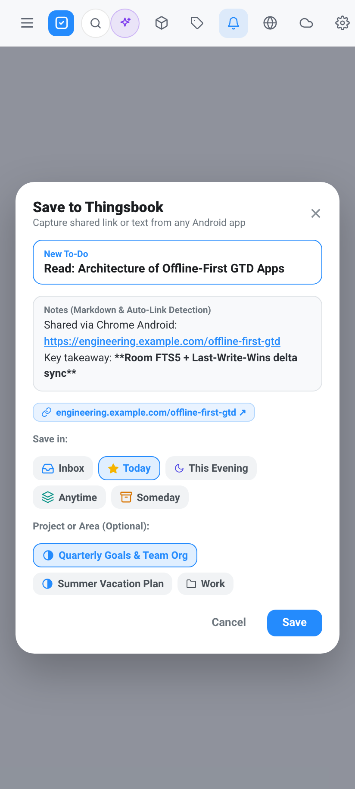
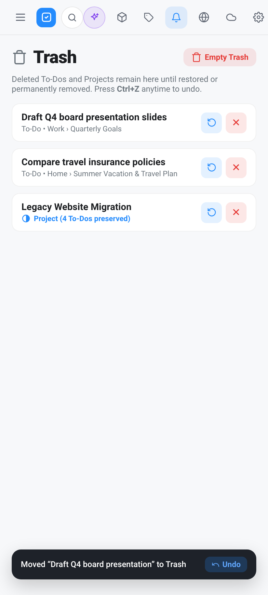
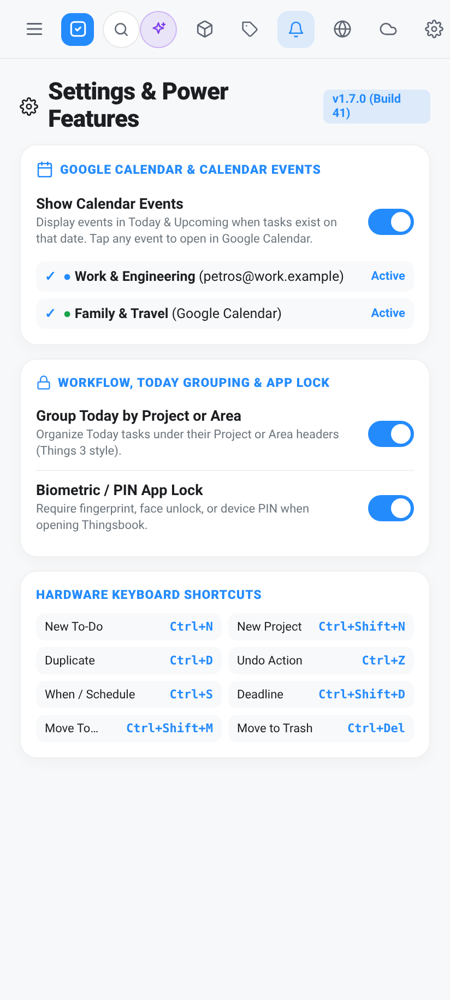
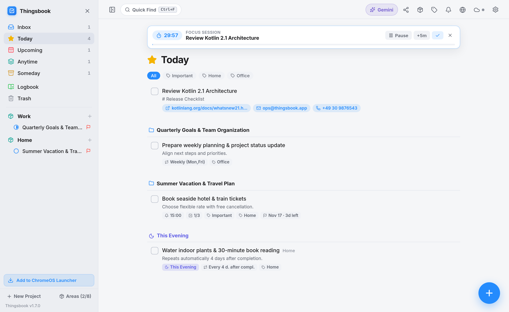

<div align="center">


# Thingsbook

**Native Android GTD Productivity App — with Companion Standalone App for ChromeOS**

[-248BFD?style=flat-square)](https://github.com/petrosvassiliou/thingsbook-android/releases/tag/v1.7.0)
[](#1-thingsbook-for-android-native-apk)
[](#2-thingsbook-for-chromeos-standalone-pwa)
[](#localization-5-languages)
[](#offline-first-storage-backups--cloud-sync)

[**📱 Download Android APK (v1.7.0)**](https://github.com/petrosvassiliou/thingsbook-android/raw/v1.7.0/releases/Thingsbook-v1.7.0-GTD-Full.apk) · [**🤖 Android Overview & Screenshots**](#1-thingsbook-for-android-native-apk) · [**💻 ChromeOS Version & Screenshots**](#2-thingsbook-for-chromeos-standalone-pwa) · [**🇩🇪 Deutsch**](#-deutsche-dokumentation)

</div>

---

## ⚠️ Independence Disclaimer / Unabhängigkeits-Erklärung

> **EN:** **Thingsbook** is an independent software project and is **in no way affiliated with, endorsed, or sponsored by Cultured Code GmbH & Co. KG** (the creators of *Things* / *Things 3*). Thingsbook operates **100% independently** and has **no data connection, interface, or compatibility with the official "Things Cloud" or any Cultured Code servers**. All data is stored strictly locally on your device (Room/SQLite on Android, IndexedDB on ChromeOS) and optionally synced via this project's own independent Firebase Firestore backend.
>
> **DE:** Dieses Projekt ist eine komplett unabhängige Eigenentwicklung und steht in **keinerlei geschäftlicher, technischer oder rechtlicher Verbindung zur Cultured Code GmbH & Co. KG** (den Entwicklern von *Things* / *Things 3*). **Thingsbook funktioniert zu 100 % eigenständig** und besitzt **keinerlei Datenverbindung, Schnittstelle oder Kompatibilität zur offiziellen „Things Cloud“ oder sonstigen Servern von Cultured Code**. Alle Daten werden ausschließlich lokal auf dem jeweiligen Gerät sowie optional im eigenen Firebase-Firestore-Backend des Projekts gespeichert.

---

# 1. Thingsbook for Android (Native APK)

**Thingsbook for Android** (`app/`) is a 100% native GTD (*Getting Things Done*) productivity app built from scratch for **Android smartphones, tablets, and foldables** using **Kotlin**, **Jetpack Compose (Material 3)**, and an **offline-first Room + SQLite FTS5 (`unicode61`) database**.

### 📥 Direct Android Download (`v1.7.0`, Build `41`)
- **[Download `Thingsbook-v1.7.0-GTD-Full.apk`](https://github.com/petrosvassiliou/thingsbook-android/raw/v1.7.0/releases/Thingsbook-v1.7.0-GTD-Full.apk)**
- **[Download `Thingsbook-Full-GTD-Edition.apk`](https://github.com/petrosvassiliou/thingsbook-android/raw/v1.7.0/Thingsbook-Full-GTD-Edition.apk)**

---

### 📸 Android Screenshots (`v1.7.0`)

#### Android Smartphones (`< 700dp` — Focus Timer, Google Calendar, Markdown Notes & Dark Mode)

<div align="center">
<table>
  <tr>
    <td align="center"><b>Today: Focus Timer, Calendar, Project Grouping &amp; Undo</b></td>
    <td align="center"><b>Inline Card: Live Markdown Notes &amp; Link Chips</b></td>
    <td align="center"><b>Project &amp; Headings (Dark): Duplicate &amp; Links</b></td>
  </tr>
  <tr>
    <td></td>
    <td></td>
    <td></td>
  </tr>
</table>
</div>

#### Android GTD Power Pack (`v1.7.0` — Quick Share Sheet, Trash & Undo, Calendar & Security Settings)

<div align="center">
<table>
  <tr>
    <td align="center"><b>&ldquo;Share to Thingsbook&rdquo; Quick Entry Sheet</b></td>
    <td align="center"><b>Trash / Recently Deleted &amp; 5s Undo Bar</b></td>
    <td align="center"><b>Settings: Calendar, Grouping &amp; Biometric Lock</b></td>
  </tr>
  <tr>
    <td></td>
    <td></td>
    <td></td>
  </tr>
</table>
</div>

#### Android Tablets & Unfolded Foldables (`>= 700dp` — Persistent 2-Column Workspace)


---

### ✨ What’s New in `v1.7.0` (Major GTD Power Pack)

1. **📤 "Share to Thingsbook" (`ACTION_SEND`) & Quick Entry Sheet**
   - Share URLs, articles, emails, or text from Chrome, Gmail, or any Android app directly into Thingsbook.
   - Opens the **Save to Thingsbook** quick-capture sheet with editable title, Markdown notes, detected link chips, and one-tap destination selection (*Inbox*, *Today*, *This Evening*, *Anytime*, *Someday*, or any *Project* / *Area*).
2. **🚀 Launcher App Shortcuts & Home Screen Widget Deep-Links**
   - Long-press the Thingsbook app icon on your Android home screen for instant actions: **New To-Do**, **Today**, **Inbox**, and **Quick Find**.
   - Interactive home screen widget (`+` quick-add and direct task opening).
3. **🔔 Actionable Reminder Notifications (`✓ Complete`, `+1h`, `Tomorrow`)**
   - Task reminder notifications now include three direct action buttons: **✓ Complete**, **+1h (Snooze)**, and **Tomorrow** (defers the task to tomorrow in *Upcoming*) without even opening the app.
4. **📝 Live Markdown Formatting & Clickable Link / Email / Phone Chips in Notes**
   - Task and project notes highlight `# Headings`, `**bold**`, `*italic*`, `` `inline code` ``, `- ` bullet lists, and URLs in real time.
   - Automatically detects web links (`https://...`), email addresses (`mailto:`), and phone numbers (`tel:`) and renders one-tap clickable chips directly below the notes field.
5. **📅 Optional Google Calendar & Device Calendar Integration**
   - Disabled by default; enable in **⚙️ Settings → Google Calendar & Calendar Events** and pick one or more specific calendars (or *All* / *None*).
   - Displays read-only calendar events in **Today** and **Upcoming** only on dates that have scheduled tasks, and tapping any calendar item opens it directly in the default Google Calendar app.
6. **🗂️ Group Today by Project / Area (`⚙️ Settings`)**
   - Optional toggle in **⚙️ Settings → Workflow, Today Grouping & App Lock** (off by default) to organize daytime tasks in **Today** under clickable *Project* or *Area* headers (*Things 3* style).
7. **🗑️ Trash / Recently Deleted View + 5-Second "Undo" Snackbar (`Ctrl + Z`)**
   - Completing or deleting a To-Do (or deleting a Project) displays a floating 5-second **Undo** bar (also triggered via `Ctrl + Z`).
   - Dedicated **Trash** smart view in the sidebar allows restoring soft-deleted tasks and projects, deleting them forever, or emptying the entire Trash.
8. **📋 Duplicate To-Do & Duplicate Project (Templates — `Ctrl + D`)**
   - Deep-clone any To-Do (including all checklist items and tags) or any Project (including headings, open tasks, checklists, and tags) via the task toolbar, context menu, project header, or `Ctrl + D`.
9. **⏱️ Built-in 25-Minute Focus / Pomodoro Timer per Task**
   - Start a 25-minute countdown on any To-Do from the task toolbar or menu.
   - Displays an interactive top **Focus Session** banner (**Pause/Resume**, **+5m**, **Complete `✓`**, **Stop `✕`**) synchronized with a silent ongoing Android notification.
10. **🔒 Optional Biometric / PIN App Lock (`⚙️ Settings`)**
    - Optional toggle in **⚙️ Settings → Workflow, Today Grouping & App Lock** (off by default) using Android's `BiometricPrompt` / `KeyguardManager` to require fingerprint, face unlock, or device PIN when opening or resuming Thingsbook.
11. **🌙 Automatic `00:00` Midnight Day Rollover & Keyboard-Safe Task Scrolling**
    - Automatically rolls over *Today* and *Upcoming* at `00:00` midnight (and upon timezone/date changes) while the app is open, and automatically scrolls expanded bottom tasks above the soft keyboard (`imePadding`).

---

### 🏗️ Core Native Android Architecture & GTD Features

- **Adaptive Layout for Phones, Tablets & Foldables (`700dp` Breakpoint)**
  - **Smartphones (`< 700dp`):** Thumb-friendly navigation drawer, swipe-down *Quick Find*, fluid 120 Hz spring card expansion (`spring(dampingRatio = 0.8f, stiffness = 400f)`), and draggable **Magic Plus (`+`)** Floating Action Button for direct drag-and-drop creation into lists.
  - **Tablets & Foldables (`>= 700dp`):** 2-column master-detail workspace with persistent sidebar, live Smart View badges, live pie-chart project progress rings, centered reading canvas (`max 840dp`), and full hardware keyboard shortcuts.
- **Complete GTD Hierarchy**
  - **Smart Views:** *Inbox*, *Today* (with a separate **🌙 This Evening** section), *Upcoming* (grouped day-by-day timeline), *Anytime*, *Someday*, *Logbook*, and *Trash*.
  - **Areas, Projects & Headings:** Group responsibilities into **Areas**, track multi-step **Projects** with live pie-chart **Progress Rings** and target dates (`🏁`), and structure projects with collapsible **Headings**.
  - **Rich To-Dos:** Reorderable **Checklists**, **Natural Language Date Input** (*"tomorrow"*, *"next fri"*, *"in 3 days"*), flexible **Recurrence Rules** (*fixed schedule* or *X days/weeks/months after completion*), exact alarm notifications & daily morning digest, hierarchical **Tags**, LexoRank `sortOrder`, and long-press on the checkbox to mark **Canceled (`✕`)**.
- <a id="offline-first-storage-backups--cloud-sync"></a>**Offline-First Room/SQLite FTS5 + Encrypted `.tbbackup` + Cloud Sync**
  - **Room + SQLite FTS5 (`unicode61 remove_diacritics 2`):** Instant sub-millisecond full-text search across titles, notes, projects, and checklist items — works 100% offline, including an optional strict **Local-Only Mode**.
  - **Encrypted `.tbbackup` Backup & Restore:** Single-file atomic backup of all entities & preferences — plain or password-encrypted with **AES-256-GCM** & **PBKDF2-HMAC-SHA256 (`120,000` iterations)** — plus CSV import/export.
  - **Optional Bidirectional Firebase Delta Sync:** Multi-device account sync via Firebase Auth + Firestore (`whereGreaterThan("updatedAt", lastSyncTimestamp)`, batched writes, Last-Write-Wins conflict resolution, and soft-delete tombstones).
- **4 Multilingual Gemini AI Features (Optional — Bring Your Own Key)**
  1. **✨ Magic Breakdown:** Breaks complex tasks into 4–7 concrete checklist steps in one tap.
  2. **🧠 Brain Dump → GTD Import:** Parses unstructured thoughts into scheduled tasks with dates, deadlines, tags, and checklists.
  3. **📐 AI Project Architect:** Designs a complete project with phases (*Headings*) and actionable *To-Dos* from a goal description.
  4. **📖 Logbook AI Reflection:** Summarizes completed tasks in your Logbook and suggests next focus tasks for *Today*.
- <a id="localization-5-languages"></a>**Full 5-Language Localization (`DE`, `EN`, `FR`, `IT`, `ES`)**
  - Zero hardcoded UI strings, instant in-app language switcher (`AppCompatDelegate.setApplicationLocales`), localized recurrence summaries, and a 5-language natural language date parser.

### 🛠️ Build Android APK Locally
```bash
./gradlew assembleRelease
```

---

# 2. Thingsbook for ChromeOS (Standalone PWA — `v1.7.0`)

Alongside the native Android APK, this repository includes a completely separate **ChromeOS Standalone PWA** (`chromeos-pwa/`) engineered specifically for Chromebooks — with **full `v1.7.0` feature and data parity** — without requiring the Linux container (Crostini) or Android VM (ARCVM).

### 🚀 Launch & Install on ChromeOS
- **Live App URL:** **[https://thingsbook-prod.web.app](https://thingsbook-prod.web.app)** *(hosted on Firebase Hosting)*
- **Pin to ChromeOS Start Menu (Launcher) & Shelf:**
  1. Open **`https://thingsbook-prod.web.app`** in Chrome on your Chromebook.
  2. Click **"Add to ChromeOS Launcher"** in the bottom-left sidebar (or the **Install `⊕` icon** in the Chrome address bar).
  3. Thingsbook installs as a standalone Chromebook application in your **Start Menu (Launcher)** and **Shelf**, opens in its own frameless window, registers as a **ChromeOS Share Target** + **Launcher Shortcut** provider (*New To-Do*, *Today*, *Inbox*, *Upcoming*, *Quick Find*), and runs **100% offline** via IndexedDB + Service Worker.

### ✨ ChromeOS `v1.7.0` GTD Power Pack Parity
- **📤 Web Share Target & Quick Share Modal:** Share links or text from ChromeOS apps directly into Thingsbook (or click the top-bar **Share** icon) with instant destination selection.
- **⏱️ 25-Minute Focus / Pomodoro Timer:** Start an interactive 25m focus session banner (**Pause/Resume**, **+5m**, **Complete `✓`**, **Stop `✕`**) on any To-Do.
- **📝 Live Markdown Notes & Link Chips:** Real-time Markdown preview plus automatic clickable **Web**, **Email (`mailto:`)**, and **Phone (`tel:`)** chips on tasks and projects.
- **🗑️ Trash View (`Ctrl + 7`) & 5s Undo Bar (`Ctrl + Z`):** Soft-delete safety net with instant Undo, individual Restore / Delete Forever, and Empty Trash.
- **📋 Duplicate To-Do & Duplicate Project (`Ctrl + D`):** Deep-clone tasks (with checklists & tags) and projects (with headings, open tasks, checklists & tags).
- **🔔 Actionable ChromeOS Notifications:** Service Worker notifications with **`✓ Complete`**, **`+1h`**, and **`Tomorrow`** action buttons.
- **🗂️ Group Today by Project / Area & 📅 Google Calendar / `.ics` Events:** Optional *Things 3*-style Today grouping and read-only Google Calendar / `.ics` agenda integration.
- **🔒 Chromebook Fingerprint (WebAuthn) / PIN App Lock:** Optional local app lock in **⚙️ Settings** using platform WebAuthn biometrics or SHA-256 PIN with automatic 60s background re-lock.

---

### 📸 ChromeOS Screenshots (`v1.7.0`)

#### Chromebook Light Mode — *Today* Grouped by Project/Area, 25m Focus Timer, Link Chips & *Trash*


#### Chromebook Dark Mode — Project Progress Ring, Collapsible Headings, Duplicate Project & *Magic Plus* (`Ctrl+N` / `Ctrl+Shift+N`)


#### Chromebook *Thingsbook Intelligence* — Multilingual Gemini AI Hub


---

### ⌨️ Hardware Keyboard Shortcuts (Android Foldables, Tablets & ChromeOS)

| Shortcut | Action |
| :--- | :--- |
| `Ctrl + N` / `Cmd + N` | **New To-Do** in the active view (works globally, even while editing) |
| `Ctrl + Shift + N` / `Cmd + Shift + N` | **New Project** modal (pre-selects the active Area or current Project's Area) |
| `Ctrl + D` / `Cmd + D` | **Duplicate** the expanded To-Do (or current Project) with all checklists & tags |
| `Ctrl + Z` / `Cmd + Z` | **Undo** the last task completion or deletion |
| `Ctrl + S` / `Cmd + S` | Open **When / Schedule** picker for the expanded To-Do |
| `Ctrl + Shift + D` / `Cmd + Shift + D` | Open **Deadline** picker for the expanded To-Do |
| `Ctrl + Shift + M` / `Cmd + Shift + M` | Open **Move to Project / Area** picker for the expanded To-Do |
| `Ctrl + Backspace` / `Ctrl + Delete` | Move the expanded or selected To-Do(s) to **Trash** |
| `Ctrl + F` or `Ctrl + K` | Toggle **Quick Find** instant search |
| `Ctrl + G` | Open **Thingsbook Intelligence (Gemini AI Hub)** |
| `Ctrl + 1` … `Ctrl + 7` | Jump to *Inbox*, *Today*, *Upcoming*, *Anytime*, *Someday*, *Logbook*, or *Trash* |
| `Ctrl + A` | Select all visible To-Dos in the current view for batch actions |
| `Ctrl + <TagKey>` | Toggle single-key **Tag Shortcut** on selected/expanded To-Do(s) |
| `Double-Click` / `Enter` | Expand or collapse a To-Do card inline |
| `Esc` | Close active popover, modal, Quick Find, expanded card, or selection |

### 🔄 Seamless Android ↔ ChromeOS Interoperability
- **Real-Time Delta Sync:** Sign in with the same account on your Android phone and your Chromebook to sync *Areas*, *Projects*, *Headings*, *Tasks*, *Checklists*, and *Tags* in real time via `thingsbook-prod` Firestore.
- **Identical `.tbbackup` Binary Format:** Export an AES-256-GCM encrypted `.tbbackup` file on Android and restore it directly on ChromeOS (or vice versa) with 100% cryptographic and schema compatibility (including `groupTodayByProjectOrArea`).

### 🛠️ Build & Deploy ChromeOS PWA
```bash
# Local development & production build
cd chromeos-pwa
npm install
npm run build

# Deploy to Firebase Hosting (https://thingsbook-prod.web.app)
cd ..
./deploy-chromeos-pwa.sh
```

---

## 🇩🇪 Deutsche Dokumentation

### 1. Thingsbook für Android (Native Android-App — `v1.7.0`, Build `41`)
Eine eigenständige, native Android-Produktivitäts-App für **Android-Smartphones, Tablets & Foldables**, entwickelt mit **100 % Kotlin**, **Jetpack Compose**, **Offline-First Room Database (SQLite FTS5 `unicode61`)**, **AES-256-GCM `.tbbackup` Komplett-Backup**, optionalem **Firebase Firestore Delta-Sync**, **4 Gemini-KI-Funktionen** und **5 Sprachen (`DE`, `EN`, `FR`, `IT`, `ES`)**.
- **📱 Direkt-Download Android-APK (`v1.7.0`):** **[Thingsbook-v1.7.0-GTD-Full.apk herunterladen](https://github.com/petrosvassiliou/thingsbook-android/raw/v1.7.0/releases/Thingsbook-v1.7.0-GTD-Full.apk)**

#### ✨ Alle neuen Funktionen in `v1.7.0`:
- **„An Thingsbook teilen“ (`ACTION_SEND`) & Schnellerfassungs-Dialog:** Links, Artikel, E-Mails oder Texte aus jeder Android-App direkt in Thingsbook speichern (inkl. Auswahl von *Eingang*, *Heute*, *Heute Abend*, *Jederzeit*, *Irgendwann* oder *Projekt*/*Bereich*).
- **App-Icon-Kurzbefehle (Launcher Shortcuts):** Langer Druck auf das App-Icon für **Neue Aufgabe**, **Heute**, **Eingang** und **Schnellsuche**.
- **Direkte Benachrichtigungs-Aktionen:** Erinnerungs-Benachrichtigungen bieten jetzt 3 Direkt-Buttons: **✓ Erledigen**, **+1 Std. (Snooze)** und **Morgen**.
- **Live-Markdown & Klickbare Links in Notizen:** Hebt `# Überschriften`, `**Fett**`, `*Kursiv*`, `` `Code` ``, `- ` Listen und URLs live hervor und zeigt anklickbare Link-, E-Mail- und Telefon-Chips direkt unter dem Notizfeld.
- **Optionale Google-Kalender-Integration:** In den Einstellungen zuschaltbar (standardmäßig aus); zeigt Termine ausgewählter Kalender in *Heute* und *Geplant* an Tagen mit Aufgaben und öffnet Termine per Tipp direkt in der Google Kalender-App.
- **„Heute nach Projekt oder Bereich gruppieren“:** Optionale Things-3-Gruppierung in den Einstellungen.
- **Papierkorb (`Trash`) & 5-Sekunden-„Rückgängig“-Leiste (`Strg + Z`):** Gelöschte Aufgaben und Projekte wiederherstellen oder endgültig leeren.
- **Aufgaben & Projekte duplizieren (`Strg + D`):** Komplettes Klonen inkl. Checklisten, Überschriften und Tags als Vorlage.
- **Integrierter 25-Minuten-Fokus-/Pomodoro-Timer:** Direkt an jeder Aufgabe startbar mit Fortschritts-Banner (*Pause*, *+5m*, *Erledigen*, *Stopp*) und stiller Android-Benachrichtigung.
- **Optionale Biometrie-/PIN-App-Sperre:** Schutz per Fingerabdruck, Gesichtserkennung oder Geräte-PIN beim Öffnen der App.
- **Erweiterte Hardware-Tastaturkürzel:** `Strg + N` (Neue Aufgabe), `Strg + Umschalt + N` (Neues Projekt), `Strg + D` (Duplizieren), `Strg + Z` (Rückgängig), `Strg + S` (Wann/Planen), `Strg + Umschalt + D` (Frist), `Strg + Umschalt + M` (Verschieben), `Strg + Rücktaste/Entf` (Löschen).

### 2. Thingsbook für ChromeOS (Eigenständige Standalone-PWA — `v1.7.0`)
Zusätzlich enthält `chromeos-pwa/` ein komplett separates **ChromeOS-Paket mit voller `v1.7.0`-Funktionsparität** (inkl. *Web Share Target*, *25-Min.-Fokus-Timer*, *Live-Markdown & Link-Chips*, *Papierkorb & Rückgängig*, *Aufgaben/Projekte duplizieren*, *Heute-Gruppierung*, *Google-Kalender/.ics-Termine*, *Direkt-Aktionen in Benachrichtigungen* sowie *WebAuthn-Fingerabdruck-/PIN-Sperre*) — gehostet auf **Firebase Hosting** und **ohne Linux-Entwicklungsumgebung (Crostini)** direkt im **ChromeOS-Startmenü (Launcher) & Shelf** installierbar:
- **💻 Live-App für Chromebooks:** **[https://thingsbook-prod.web.app](https://thingsbook-prod.web.app)** *(in Chrome öffnen → „Zum ChromeOS-Launcher hinzufügen“ klicken → startet im eigenen Fenster, 100 % offline-fähig via IndexedDB + Service Worker und synchronisiert nahtlos mit der Android-App).*

---

## 📂 Repository Structure

```text
thingsbook-android/
├── app/                     # 1. Native Android APK (Kotlin, Jetpack Compose, Room + SQLite FTS5)
├── chromeos-pwa/            # 2. Standalone ChromeOS PWA (TypeScript, React, IndexedDB + Workbox)
├── docs/screenshots/        # Retina UI screenshots (Android Phone, Android Tablet & ChromeOS)
├── releases/                # Signed release APKs (Thingsbook-v1.7.0-GTD-Full.apk)
├── firebase.json            # Firebase Hosting & Firestore configuration
├── firestore.rules          # Per-user Firestore security rules
└── deploy-chromeos-pwa.sh   # One-command build & Firebase Hosting deployment script
```
