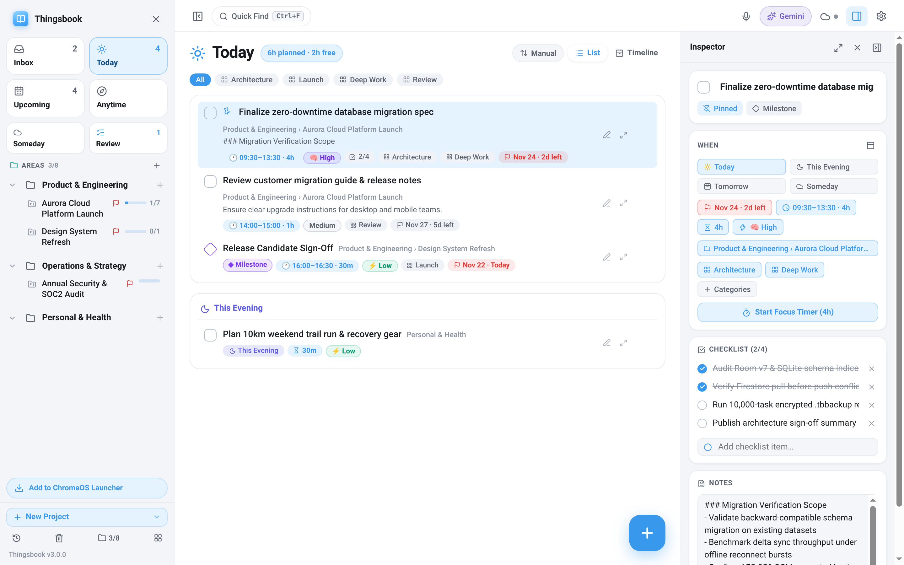
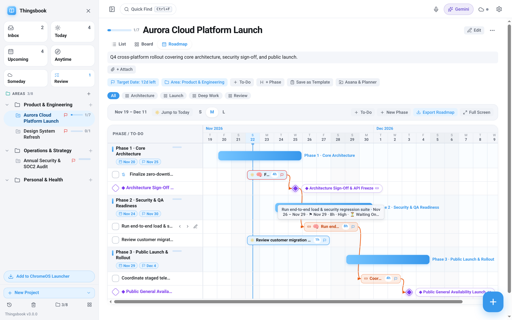
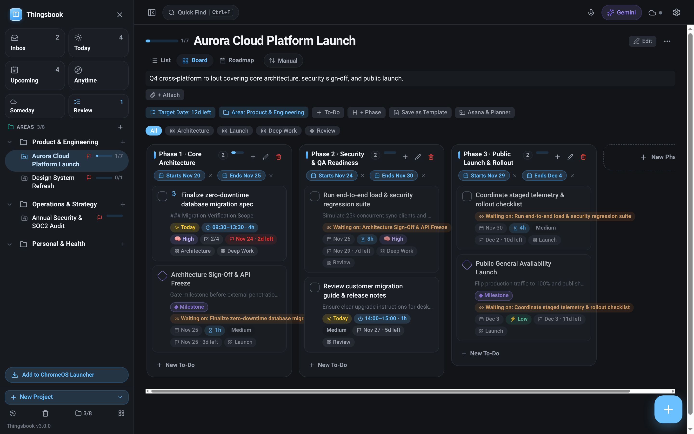
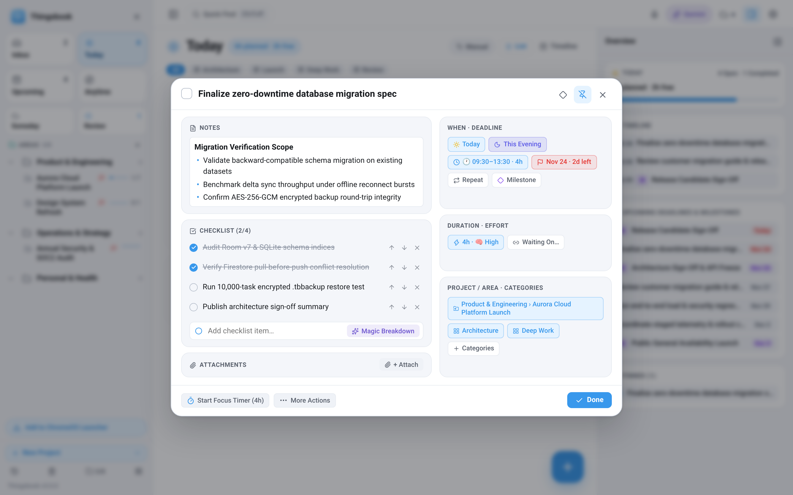
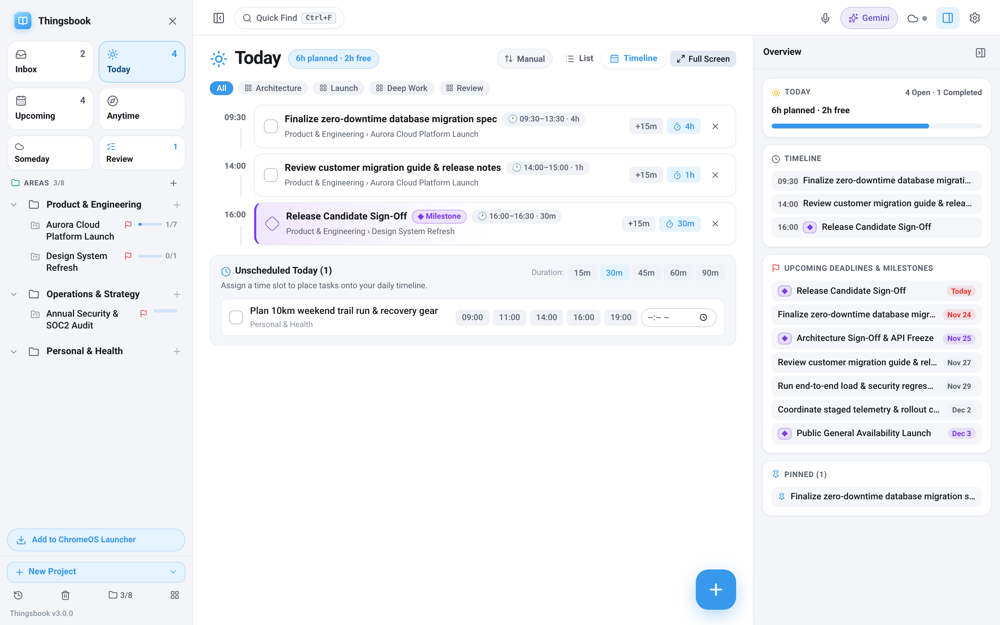
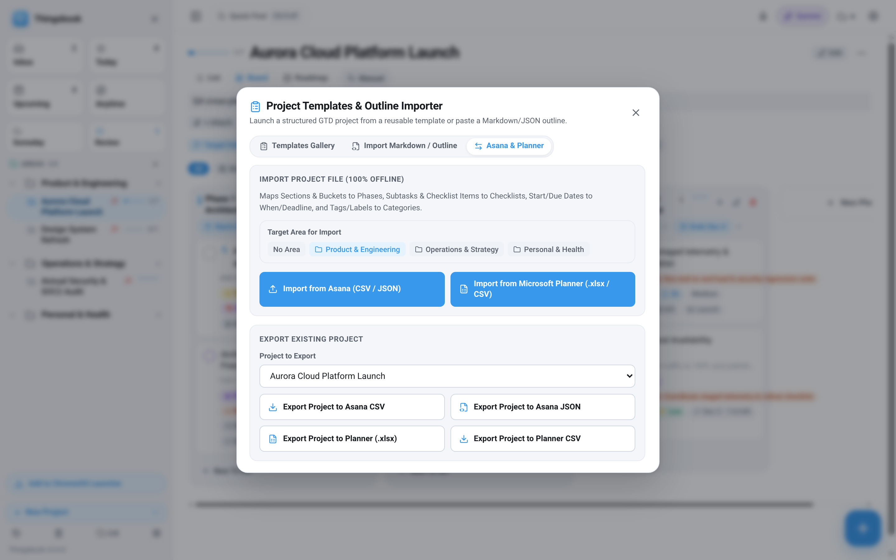
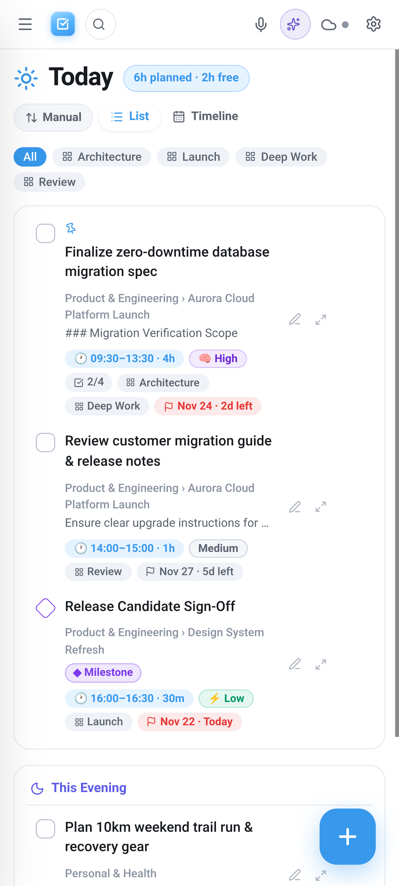
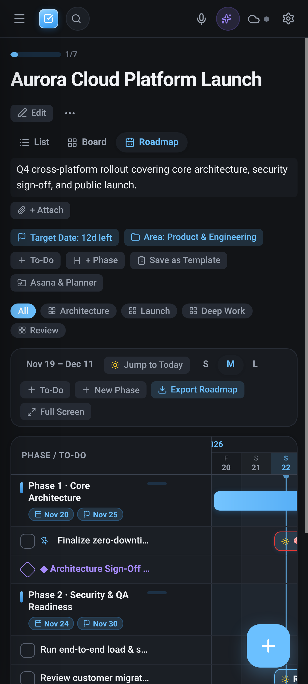

<div align="center">


# Thingsbook

**Native GTD & Visual Project Planning Suite for Android, ChromeOS & macOS (`v3.1.0`, Build `113`)**

[-248BFD?style=flat-square)](https://github.com/petrosvassiliou/thingsbook-android/releases/tag/v3.1.0)
[](#1-thingsbook-for-android--googlebook-os-native-apk--v300)
[](#2-thingsbook-for-chromeos--web-standalone-pwa--v300)
[](#3-thingsbook-for-macos-native-universal-app--v300)
[-6E56CF?style=flat-square)](#localization-5-languages)
[](#offline-first-storage-backups--cloud-sync)

[**📱 Download Android APK (v3.1.0)**](https://github.com/petrosvassiliou/thingsbook-android/releases/download/v3.1.0/Thingsbook-v3.1.0-GTD-Full.apk) · [**🍎 Download macOS Universal DMG (v3.1.0)**](https://github.com/petrosvassiliou/thingsbook-android/releases/download/v3.1.0/Thingsbook-macOS-v3.1.0-Universal.dmg) · [**💻 Launch ChromeOS / Web App**](https://thingsbook-prod.web.app) · [**📦 GitHub Releases**](https://github.com/petrosvassiliou/thingsbook-android/releases/latest) · [**🇩🇪 Deutsch**](#-deutsche-dokumentation)

</div>

---

## ⚠️ Independence Disclaimer / Unabhängigkeits-Erklärung

> **EN:** **Thingsbook** is an independent software project and is **in no way affiliated with, endorsed, or sponsored by Cultured Code GmbH & Co. KG** (the creators of *Things* / *Things 3*). Thingsbook operates **100% independently** and has **no data connection, interface, or compatibility with the official "Things Cloud" or any Cultured Code servers**. All data is stored strictly locally on your device (Room/SQLite on Android, IndexedDB on ChromeOS, SQLite3 + WAL on macOS) and optionally synced via this project's own independent Firebase Firestore backend.
>
> **DE:** Dieses Projekt ist eine komplett unabhängige Eigenentwicklung und steht in **keinerlei geschäftlicher, technischer oder rechtlicher Verbindung zur Cultured Code GmbH & Co. KG** (den Entwicklern von *Things* / *Things 3*). **Thingsbook funktioniert zu 100 % eigenständig** und besitzt **keinerlei Datenverbindung, Schnittstelle oder Kompatibilität zur offiziellen „Things Cloud“ oder sonstigen Servern von Cultured Code**. Alle Daten werden ausschließlich lokal auf dem jeweiligen Gerät (Android, ChromeOS, macOS) sowie optional im eigenen Firebase-Firestore-Backend des Projekts gespeichert.

---

## ✨ What’s New in `v3.1.0` (Build `113`)

1. **📊 Area Portfolio Timeline with Collapsible Project Lanes & Vector PDF / High-DPI PNG Export:** Switch any Area into `Portfolio Timeline` mode to view stacked project summary bars with overlaid **45° Royal-Violet Milestone Diamonds (`◆`)**, expand projects inline to drag Phase/Task bars, present in Full-Screen (`F` / `⌃⌘F`), and export multi-page **A4 Vector PDFs** or **High-DPI PNGs**.
2. **🔗 Smart Push-on-Conflict Cascading Dependencies + Multi-Task Undo:** Dragging a prerequisite task forward automatically cascades overlapping `Waiting On` dependents forward in real time (preserving slack when non-overlapping) with atomic `Cmd+Z` / `Ctrl+Z` Undo across all platforms.
3. **⚖️ Configurable Workday Hours & 7-Day Workload Forecast:** Set custom **Workday Start / End** hours in Settings (synced in `.tbbackup`) and track a **7-Day Workload** strip + daily overload indicators across **Upcoming** and the **Wide-Screen Inspector**.
4. **🧠 `v3`-Aware Gemini Roadmap Architect & `"Plan My Day"` Auto-Timeblocker:** Generate complete Gantt projects with dated Phases, `◆` Milestones, Effort, Durations & Dependencies, or click **`✨ Plan My Day`** in **Today** to preview, tweak (`±15m`), and apply conflict-free focus blocks around your calendar (`675` localized keys across `DE`, `EN`, `FR`, `IT`, `ES`).

---

## 🚀 What’s New in `v3.0.0` (Build `111`) — Major Cross-Platform Release

1. **📊 Three-Mode Project Workspaces: `📋 List` · `🗂️ Kanban Board` · `📊 Interactive Gantt Timeline`**
   - **Kanban Board by Project Phases:** Drag and drop single or multiple selected tasks across Phase columns, track per-phase completion rings, assign Phase Start & End dates, and promote or clear ungrouped (*General*) tasks cleanly.
   - **Interactive Gantt Timeline / Roadmap:**
     - Visualize Phases, multi-day task spans, **45° Royal-Violet Milestone Diamonds (`◆`)** with floating callout pills, and curved SVG **`Waiting On` dependency connectors**.
     - **Press-and-Drag Rescheduling:** Hold and drag tasks, milestones, or entire phases horizontally to shift schedules cleanly with zero accidental hover drift.
     - **Mouse-Only Timeline Hover Tooltips:** Hovering with a mouse or trackpad cursor over tasks in Timeline view surfaces a discreet floating summary (title, date span, deadline, duration, effort, checklist count, and blocked status) while remaining silent during touch interactions.
     - **Full-Screen Presentation Mode & Vector PDF / High-DPI PNG Export:** Present roadmaps distraction-free (`F` / `⌃⌘F`) or export crisp multi-page **A4/Letter Vector PDFs** and **High-DPI PNGs** with custom date windows and phase selection.
2. **🍱 Redesigned Two-Column Soft Bento Task Modal & Wide-Screen Inspector**
   - **Soft Bento Task Editor Modal:** Symmetric two-column workspace pairing **Markdown Notes + Interactive Checklists** (with `✨` Magic Breakdown) on the left with **Schedule (`When`, `Deadline`, `Milestone ◆`, `Repeat`, `Timeblock`), Effort (`Low` / `Medium` / `High`), Duration (`5m`–`8h` + multi-day), Dependencies (`Waiting On`), Organization (`Area / Project / Phase`), Tags, and Attachments** on the right.
   - **Wide-Screen Right-Side Inspector Panel:** Maximized windows on Googlebook OS, ChromeOS, Android tablets, and macOS automatically unlock a Soft Bento **Inspector / Context Panel**—displaying live task inspection & quick actions when a task is selected, or a **Today Focus / Project Progress / Smart View Overview** when nothing is selected.
3. **🔄 Asana & Microsoft Planner Import/Export with Target Area Preselection**
   - Round-trip **Asana JSON** (including `resource_subtype: "milestone"`, Sections/Phases, Subtasks, Tags, Notes, and Deadlines) and **Microsoft Planner / Todoist CSV** import & export—complete with a **Target Area preselector** and right-click Area import actions.
4. **🔗 Task Dependencies (`Waiting On`), 📌 Pinned Tasks, ⚡ Effort Scale & `4h` / `8h` Full-Day Durations**
   - Link prerequisite tasks with circular-dependency protection and automatic `⏳` blocked indicators; pin priority items to the top of views; classify cognitive/work Effort (`Low` / `Medium` / `High`); and estimate task durations from `5m` up to `4h` (half-day), `8h` (full-day), and multi-day spans.
5. **🔍 Optional Custom Perspectives, 🧭 Weekly Review, 📋 Templates, 🧠 BYOK Gemini AI & Instant Cloud Sync**
   - Sidebar stays clean by default with optional multi-rule **Custom Perspectives** enabled anytime in Settings, alongside the **4-Step Weekly Review (`Ctrl+Shift+R` / `⇧⌘R`)**, **Synced Project Templates**, **Today Interleaved Daily Timeline**, **Optional BYOK Gemini AI Hub**, **Real-Time Firestore Delta Sync**, **AES-256-GCM `.tbbackup`**, and **100% 5-language parity (`650` keys across `EN`, `DE`, `FR`, `IT`, `ES`)**.

---

## 🖼️ High-Resolution `v3.0.0` Retina Showcase

### Today Workspace + Wide-Screen Right-Side Soft Bento Inspector (`2880×1800` Retina)


### Interactive Project Gantt Timeline — Milestones (`◆`), Dependencies & Mouse Hover Tooltips (`2880×1800` Retina)


### Project Kanban Board in Dark Mode — Phases, Progress Rings, Effort & Durations (`2880×1800` Retina)


### Two-Column Soft Bento Task Editor Modal — Markdown Notes, Checklists, Milestones & Timeblocks (`2880×1800` Retina)


### Today Interleaved Daily Timeline & Asana / Microsoft Planner Import (`2880×1800` Retina)

<div align="center">
<table>
  <tr>
    <td align="center"><b>Today Daily Timeline (Calendar Events + Timeblocks)</b></td>
    <td align="center"><b>Project Templates &amp; Asana / Planner Import with Target Area</b></td>
  </tr>
  <tr>
    <td></td>
    <td></td>
  </tr>
</table>
</div>

---

# 1. Thingsbook for Android & Googlebook OS (Native APK — `v3.0.0`)

**Thingsbook for Android** (`app/`) is a 100% native GTD & project planning app built from scratch for **Android smartphones, tablets, foldables, and Googlebook OS / ChromeOS ARCVM** using **Kotlin**, **Jetpack Compose (Material 3)**, and an **offline-first Room v7 + SQLite FTS5 (`unicode61`) database**.

### 📥 Direct Android Download (`v3.0.1`, Build `112`)
- **[Download `Thingsbook-v3.0.1-GTD-Full.apk`](https://github.com/petrosvassiliou/thingsbook-android/releases/download/v3.0.1/Thingsbook-v3.0.1-GTD-Full.apk)**
- **[Download `Thingsbook-Full-GTD-Edition.apk`](https://github.com/petrosvassiliou/thingsbook-android/releases/download/v3.0.1/Thingsbook-Full-GTD-Edition.apk)**

### 📱 Mobile Portrait Views (`1236×2745` `3x` Retina)

<div align="center">
<table>
  <tr>
    <td align="center"><b>Mobile Today View (Light)</b></td>
    <td align="center"><b>Mobile Project Timeline &amp; Milestones (Dark)</b></td>
  </tr>
  <tr>
    <td></td>
    <td></td>
  </tr>
</table>
</div>

### ✨ Native Android & Googlebook Highlights (`v3.0.0`)

1. **📊 Full List, Kanban Board & Interactive Gantt Timeline with Native Vector `PdfDocument` & PNG Export**
   - Switch any project between List, Kanban Board, and Interactive Gantt Timeline with 45° Royal-Violet Milestones (`◆`), press-and-drag rescheduling, mouse-only hover tooltips on Chromebook/desktop mice, and native multi-page vector PDF & High-DPI PNG export.
2. **🖥️ Wide-Screen 3-Pane Workspace for Googlebook OS, Tablets & Foldables**
   - Responsive Soft Bento Sidebar + Fluid Task/Project Canvas + collapsible **360dp Right-Side Inspector Panel**, 1:1 desktop single-click selection parity (`Ctrl`/`Shift` multi-select), and responsive `FlowRow` batch action bar that automatically lifts the Magic Plus (`+`) FAB above selected actions.
3. **⚡ System Quick Settings Tile (`TileService`), Home Screen Widgets (`4×1` & `4×2`) & Launcher Shortcuts**
   - Instant capture from the Android Quick Settings shade, home screen widgets (*Today*, *Inbox*, *Upcoming*, *Project*, *Voice Capture*), and `"Share to Thingsbook"` (`ACTION_SEND`).
4. **🎙️ Voice-to-Task Dictation, 📎 Camera/PDF/File Attachments (`PdfRenderer`), 📍 Google Maps Chips, 🔔 Actionable Notifications & 🔒 Biometric App Lock**
   - Hands-free speech capture with optional Gemini smart parsing, compressed photo & native PDF previews, one-tap web/email/phone/map chips, Pomodoro Focus Timer, and `BiometricPrompt` security.
5. <a id="offline-first-storage-backups--cloud-sync"></a>**Offline-First Room v7 SQLite FTS5 + Encrypted `.tbbackup` + Real-Time Firestore Sync**
   - Sub-millisecond full-text search (`unicode61`), optional strict **Local-Only Mode**, **AES-256-GCM** (`PBKDF2-HMAC-SHA256`, `120,000` iterations) `.tbbackup` archives, Asana JSON / Microsoft Planner CSV import & export, and real-time multi-device Firestore delta sync with `ntfy` wake relay.
6. <a id="localization-5-languages"></a>**Full 5-Language Localization (`DE`, `EN`, `FR`, `IT`, `ES`)**
   - `650` verified localization keys per language with instant in-app switching and multilingual natural-language date & time parsing.

### 🛠️ Build Android APK Locally
```bash
./gradlew assembleRelease
```

---

# 2. Thingsbook for ChromeOS & Web (Standalone PWA — `v3.0.0`)

Alongside the native Android APK, Thingsbook includes a dedicated **Standalone Offline-First PWA** (`chromeos-pwa/`) engineered for Chromebooks and desktop browsers—delivering **100% `v3.0.0` feature, Milestone, Gantt Roadmap, Soft Bento, Cloud Sync, and `.tbbackup` parity** without requiring Crostini or ARCVM.

### 🚀 Launch & Install on ChromeOS / Desktop Browser
- **Live App URL:** **[https://thingsbook-prod.web.app](https://thingsbook-prod.web.app)** *(hosted on Firebase Hosting)*
- **Pin to ChromeOS Launcher & Shelf:**
  1. Open **`https://thingsbook-prod.web.app`** in Chrome.
  2. Click **"Add to ChromeOS Launcher"** in the sidebar (or the **Install `⊕` icon** in the address bar).
  3. Runs in its own standalone window, registers as a **Share Target** + **Launcher Shortcut** provider, and works **100% offline** via IndexedDB + Workbox Service Worker.

### ✨ ChromeOS & Web `v3.0.0` Highlights
- **📊 Interactive Project List, Kanban Board & Gantt Timeline** with press-and-drag rescheduling (both mouse press-and-drag and touch hold-and-drag), 45° Milestones (`◆`), SVG dependency curves, mouse-only hover tooltips, Full-Screen mode (`F`), and multi-page A4/Letter Vector PDF & High-DPI PNG export.
- **🍱 Two-Column Soft Bento Task Modal & Wide-Screen Right-Side Inspector Panel** (`>= 1220px` auto-docked with top-bar toggle).
- **🔄 Asana JSON & Microsoft Planner / Todoist CSV Import & Export** with Target Area preselection, **🧭 4-Step Weekly Review (`Ctrl+Shift+R`)**, **📋 Synced Project Templates**, **🗓️ Today Daily Timeline**, **🎙️ Web Speech Voice Dictation**, **📎 IndexedDB File/PDF/Image Attachments**, and **🔒 WebAuthn / PIN App Lock**.

### ⌨️ Hardware Keyboard Shortcuts (Android Tablets/Googlebook, ChromeOS & macOS)

| Shortcut | Action |
| :--- | :--- |
| `Ctrl + N` / `⌘N` | **New To-Do** in the active view or phase |
| `Ctrl + Shift + N` / `⇧⌘N` | **New Project** modal (pre-selects active Area) |
| `Ctrl + Shift + R` / `⇧⌘R` | Open **Guided 4-Step GTD Weekly Review** |
| `F` / `⌃⌘F` | Toggle **Full-Screen Presentation Mode** in Today or Project Timeline |
| `Ctrl + D` / `⌘D` | **Duplicate** selected To-Do or current Project |
| `Ctrl + Z` / `⌘Z` | **Undo** the last task completion or deletion |
| `Ctrl + S` / `⌘S` | Open **When / Schedule** picker for selected To-Do |
| `Ctrl + Shift + D` / `⇧⌘D` | Open **Deadline** picker for selected To-Do |
| `Ctrl + Shift + M` / `⇧⌘M` | Open **Move to Project / Area** picker |
| `Ctrl + Backspace` / `⌘⌫` | Move selected To-Do(s) to **Trash** |
| `Ctrl + F` / `⌘F` or `Ctrl + K` / `⌘K` | Toggle **Quick Find** instant search |
| `Ctrl + G` / `⌘G` | Open **Thingsbook Intelligence (Gemini AI Hub)** |
| `Ctrl + 1` … `Ctrl + 7` / `⌘1` … `⌘7` | Jump to *Inbox*, *Today*, *Upcoming*, *Anytime*, *Someday*, *Logbook*, or *Trash* |
| `Ctrl + A` / `⌘A` | Select all visible To-Dos in the current view for batch actions |
| `Click` / `Cmd+Click` / `Shift+Click` | Select single task (opens in Inspector) / toggle / range multi-select |
| `Double-Click` / `Enter` | Open To-Do in the **Soft Bento Task Modal** |
| `Esc` | Close active popover, modal, Quick Find, full-screen timeline, or selection |

### 🛠️ Build & Verify ChromeOS PWA Locally
```bash
cd chromeos-pwa
npm ci
npm test
npm run lint
npm run build
```

---

# 3. Thingsbook for macOS (Native Universal App — `v3.0.0`)

**Thingsbook for macOS** (`macos/`) is a **100% native Swift + SwiftUI + AppKit desktop application** for **macOS 14+ (Sonoma, Sequoia & Tahoe)** compiled as a Universal binary for both **Apple Silicon (`arm64`) and Intel (`x86_64`)** Macs—engineered in strict feature, localization (`650` keys), SQLite FTS5, `.tbbackup`, and Firestore sync parity with Android and ChromeOS (`v3.0.0`, Build `111`).

### 📥 Install or Upgrade on macOS (`v3.0.1`, Build `112`)
- **Direct Universal DMG Download:** **[Download `Thingsbook-macOS-v3.0.1-Universal.dmg`](https://github.com/petrosvassiliou/thingsbook-android/releases/download/v3.0.1/Thingsbook-macOS-v3.0.1-Universal.dmg)**
- **In-App 1-Click Updater:** Open **Settings (`⌘,`) → Updates → Install & Relaunch** to download, verify, atomically swap `/Applications/Thingsbook.app`, and relaunch without touching a `.dmg`.
- **Instant 1-Command Terminal Install / Upgrade (No Gatekeeper Prompts):**
  ```bash
  curl -fsSL https://raw.githubusercontent.com/petrosvassiliou/thingsbook-android/main/macos/install.sh | bash
  ```

### ✨ Native macOS Highlights (`v3.0.1`, Build `112`)
1. **📊 Native SwiftUI/AppKit Project List, Kanban Board & Interactive Gantt Timeline**
   - Multi-day task & phase bars, 45° Royal-Violet Milestone Diamonds (`◆`), curved dependency connectors, AppKit mouse-hover timeline tooltips, Full-Screen presentation mode (`⌃⌘F`), and native CoreGraphics multi-page Vector PDF & High-DPI PNG export.
2. **🍱 Two-Column Soft Bento Task Modal & Wide-Screen Right-Side Inspector Panel**
   - Native macOS sheet & inspector architecture with live Markdown editing, `✨` Magic Breakdown checklists, `Low`/`Medium`/`High` Effort, `5m`–`8h` + multi-day durations, `Waiting On` dependencies, and Asana JSON / Microsoft Planner CSV round-trip import & export.
3. **🎙️ Live Voice Dictation (`SFSpeechRecognizer` + `AVAudioEngine`), 🎯 `MenuBarExtra`, 📅 Apple Calendar (`EventKit`), 📎 `PDFKit` Attachments, 📍 Apple Maps Chips & 🔒 Touch ID Lock.**

---

## 🔄 Seamless Cross-Platform Interoperability & Upgrade (`v1.8 / v2.x → v3.0.1`)
- **100% Zero-Data-Loss In-Place Upgrades:**
  - **Android:** Signed with the identical persistent release certificate (`versionCode → 112`) and automatic Room migrations (`MIGRATION_2_3` through `MIGRATION_6_7`).
  - **ChromeOS:** Automatic additive IndexedDB migrations (`DB_VERSION → 5`) and Service Worker `autoUpdate`.
  - **macOS:** Automatic additive SQLite3 schema migrations (`is_milestone`, `effort_level`, `is_pinned`, `blocked_by_task_ids`, `perspectives`, phase `start_date`/`end_date`) and 1-click in-app updates.
- **Real-Time Multi-Device Delta Sync & Identical `.tbbackup` Format:** Sync seamlessly across Android, Googlebook, ChromeOS, and macOS via Firestore + `ntfy` wake relay, or transfer encrypted **AES-256-GCM `.tbbackup`** archives offline between any of the three platforms.

---

## 🇩🇪 Deutsche Dokumentation

### 1. Thingsbook für Android & Googlebook OS (Native App — `v3.0.1`, Build `112`)
Eigenständige, native GTD- & Projektplanungs-App für **Android-Smartphones, Tablets, Foldables und Googlebook OS**, entwickelt mit **100 % Kotlin**, **Jetpack Compose**, **Offline-First Room v7 (SQLite FTS5 `unicode61`)**, **AES-256-GCM `.tbbackup`**, optionalem **Firebase Firestore Echtzeit-Delta-Sync**, **BYOK Gemini-KI** und **5 Sprachen (`DE`, `EN`, `FR`, `IT`, `ES` — `650` lokalisierte Schlüssel)**. Nahtlos aktualisierbar von `v1.8.x`, `v2.x` und `v3.0.0`.
- **📱 Direkt-Download Android-APK (`v3.0.1`):** **[Thingsbook-v3.0.1-GTD-Full.apk herunterladen](https://github.com/petrosvassiliou/thingsbook-android/releases/download/v3.0.1/Thingsbook-v3.0.1-GTD-Full.apk)**

#### ✨ Highlights in `v3.0`:
- **📊 Drei Projekt-Ansichten (`📋 Liste` · `🗂️ Kanban-Board` · `📊 Interaktive Gantt-Zeitachse`):** Phasen mit Start-/Enddatum, **Meilensteine (`◆`)**, Abhängigkeiten (*Wartet auf*), Halten-&-Ziehen-Terminverschiebung, Maus-Tooltips in der Zeitachse, Vollbildmodus sowie mehrseitiger **Vektor-PDF- & High-DPI-PNG-Export**.
- **🍱 Zweispaltiger Soft-Bento-Aufgabendialog & Breitbild-Inspektor-Seitenleiste:** Symmetrischer Aufgaben-Editor (Markdown-Notizen & Checklisten links; Planung, Meilenstein `◆`, Aufwand *Niedrig / Mittel / Hoch*, Dauer `5m`–`8h` + mehrtägig, Zeitblock, Abhängigkeiten, Bereich/Projekt/Phase & Kategorien rechts) sowie rechte **Inspektor-Seitenleiste** auf großen Bildschirmen.
- **🔄 Asana-JSON- & Microsoft-Planner-/Todoist-CSV-Import & -Export** inkl. Bereichs-Vorauswahl (*Zielbereich*), Meilensteinen, Phasen und Unteraufgaben.
- **🧭 4-Schritte-GTD-Wochenrückblick (`Strg + Umschalt + R`), 📋 Projekt-Vorlagen, 🗓️ Tages-Zeitachse, 🔍 Optionale Perspektiven, 🎙️ Spracheingabe, 📎 Foto-/PDF-Anhänge & 🔒 Biometrie-Sperre.**

### 2. Thingsbook für ChromeOS & Web (Eigenständige Standalone-PWA — `v3.0.1`)
`chromeos-pwa/` bietet **100 % `v3.0.1`-Funktionsparität** (*Liste / Kanban-Board / Gantt-Zeitachse mit Meilensteinen & PDF/PNG-Export*, *Soft-Bento-Editor*, *Breitbild-Inspektor*, *Asana- & Planner-Import/Export*, *Wochenrückblick*, *Tages-Zeitachse*, *Spracheingabe*, *IndexedDB-Anhänge* und *WebAuthn-/PIN-Sperre*) — direkt ohne Linux-Container im **ChromeOS-Launcher & Shelf** installierbar:
- **💻 Live-App starten:** **[https://thingsbook-prod.web.app](https://thingsbook-prod.web.app)**

### 3. Thingsbook für macOS (Native Universal-App — `v3.0.1`, Build `112`)
`macos/` enthält die **100 % native Swift/SwiftUI/AppKit-Desktop-App für macOS 14+ (Apple Silicon & Intel)** mit voller `v3.0.1`-Parität (*Liste, Kanban-Board & Gantt-Zeitachse mit Meilensteinen `◆`, Maus-Tooltips & Vektor-PDF/PNG-Export*, *Soft-Bento-Aufgabendialog*, *Breitbild-Inspektor*, *Asana-/Planner-Import*, *In-App-Auto-Updater*, *Menüleisten-App*, *Live-Sprachdiktat*, *Apple-Kalender (`EventKit`)*, *`PDFKit`-Anhänge*, *Touch ID*, *SQLite FTS5*, *`.tbbackup`* und *Firestore Cloud-Sync*):
- **🍎 Direkt-Download Universal-DMG (`v3.0.1`):** **[Thingsbook-macOS-v3.0.1-Universal.dmg herunterladen](https://github.com/petrosvassiliou/thingsbook-android/releases/download/v3.0.1/Thingsbook-macOS-v3.0.1-Universal.dmg)**
- **⚡ 1-Befehl-Installation / Upgrade im Terminal:**
  ```bash
  curl -fsSL https://raw.githubusercontent.com/petrosvassiliou/thingsbook-android/main/macos/install.sh | bash
  ```

---

## 📂 Repository Structure

```text
thingsbook-android/
├── app/                     # 1. Native Android & Googlebook APK (Kotlin, Jetpack Compose, Room v7 + SQLite FTS5)
├── chromeos-pwa/            # 2. Standalone ChromeOS & Web PWA (TypeScript, React, IndexedDB + Workbox)
├── macos/                   # 3. Native macOS Universal App (Swift, SwiftUI, AppKit, SQLite3 FTS5 + PDFKit)
├── docs/screenshots/        # High-resolution 2x/3x Retina UI screenshots (v3.0.0)
├── releases/                # Release notes & signed release archives
├── firebase.json            # Firebase Hosting & Firestore configuration
├── firestore.rules          # Per-user Firestore security rules
└── deploy-chromeos-pwa.sh   # One-step ChromeOS PWA build & Firebase Hosting deploy script
```
