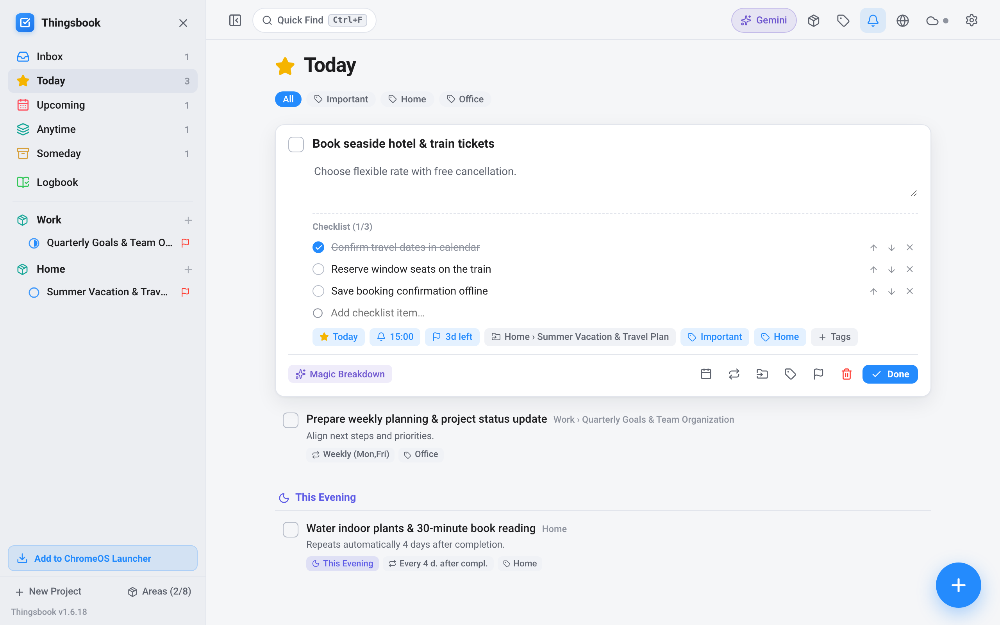
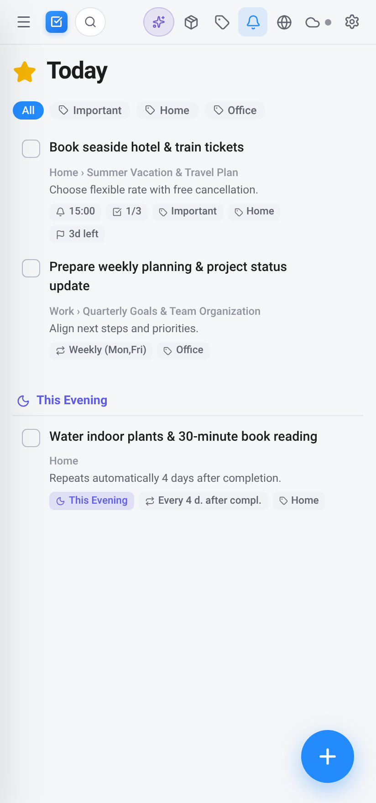
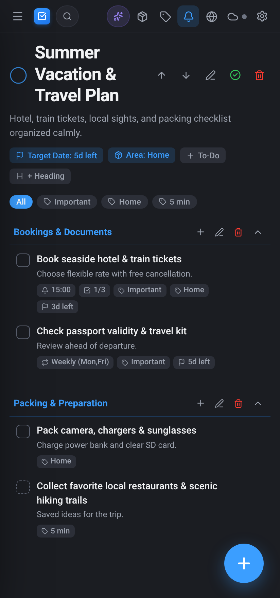

<div align="center">


# Thingsbook

**Offline-First GTD Productivity App for Android & ChromeOS**

[](https://github.com/petrosvassiliou/thingsbook-android)
[](https://github.com/petrosvassiliou/thingsbook-android/raw/main/Thingsbook-v1.6.18-full.apk)
[](https://thingsbook-prod.web.app)
[](#5-language-localization)
[](#encrypted-backups--cloud-sync)

[**🚀 Launch ChromeOS App**](https://thingsbook-prod.web.app) · [**📱 Download Android APK (v1.6.18)**](https://github.com/petrosvassiliou/thingsbook-android/raw/main/Thingsbook-v1.6.18-full.apk) · [**📸 Screenshots**](#-screenshots) · [**⌨️ Shortcuts**](#️-keyboard-shortcuts) · [**🇩🇪 Deutsch**](#-deutsche-dokumentation)

</div>

---

## ⚠️ Independence Disclaimer / Unabhängigkeits-Erklärung

> **EN:** **Thingsbook** is an independent software project and is **in no way affiliated with, endorsed, or sponsored by Cultured Code GmbH & Co. KG** (the creators of *Things* / *Things 3*). Thingsbook operates **100% independently** and has **no data connection, interface, or compatibility with the official "Things Cloud" or any Cultured Code servers**. All data is stored locally on your device (Room/SQLite on Android, IndexedDB on ChromeOS) and optionally synced via this project's own independent Firebase Firestore backend.
>
> **DE:** Dieses Projekt ist eine komplett unabhängige Eigenentwicklung und steht in **keinerlei geschäftlicher, technischer oder rechtlicher Verbindung zur Cultured Code GmbH & Co. KG** (den Entwicklern von *Things* / *Things 3*). **Thingsbook funktioniert zu 100 % eigenständig** und besitzt **keinerlei Datenverbindung, Schnittstelle oder Kompatibilität zur offiziellen „Things Cloud“ oder sonstigen Servern von Cultured Code**. Alle Daten werden ausschließlich lokal auf dem jeweiligen Gerät sowie optional im eigenen Firebase-Firestore-Backend des Projekts gespeichert.

---

## 📸 Screenshots

### Chromebook, Tablet & Foldable Workspace (`>= 700dp`)

#### Today View — Inline Card Expansion, Checklists, Magic Breakdown & *This Evening*


#### Dark Mode Project View — Live Progress Ring, Collapsible Headings & *Magic Plus* Speed Dial


#### Thingsbook Intelligence — Multilingual Gemini AI Hub (*Brain Dump → GTD* & *AI Project Architect*)


### Smartphone & Compact Split-Screen Layout (`< 700dp`)

<div align="center">
<table>
  <tr>
    <td align="center"><b>Today &amp; This Evening (Light)</b></td>
    <td align="center"><b>Project Detail &amp; Headings (Dark)</b></td>
  </tr>
  <tr>
    <td></td>
    <td></td>
  </tr>
</table>
</div>

---

## 📦 Download & Installation (`v1.6.18`)

### 1. Android (Smartphones, Tablets & Foldables)
- **Direct APK Download:** [**Thingsbook-v1.6.18-full.apk**](https://github.com/petrosvassiliou/thingsbook-android/raw/main/Thingsbook-v1.6.18-full.apk)
- Built natively with **100% Kotlin**, **Jetpack Compose**, **Material 3**, and **Room + SQLite FTS5**.

### 2. ChromeOS (Start Menu / Launcher & Shelf — *No Linux Required*)
- **Web App URL:** [**https://thingsbook-prod.web.app**](https://thingsbook-prod.web.app)
- **One-Click Chromebook Setup:**
  1. Open **`https://thingsbook-prod.web.app`** in Chrome on your Chromebook.
  2. Click **"Add to ChromeOS Launcher"** in the bottom-left sidebar (or click the **Install `⊕` icon** in the Chrome address bar).
  3. Thingsbook appears as a standalone app in your **ChromeOS Launcher (Start Menu)** and **Shelf**, launches in its own frameless window, and runs **100% offline** with zero Linux (Crostini) or Android VM overhead.

---

## ✨ Key Features

- **Complete GTD Workflow Hierarchy**
  - **Smart Views:** *Inbox*, *Today* (with a dedicated **🌙 This Evening** section), *Upcoming* (grouped day-by-day timeline), *Anytime*, *Someday*, and *Logbook*.
  - **Areas & Projects:** Organize responsibilities into **Areas** and multi-step **Projects** featuring live pie-chart **Progress Rings**, target dates (`🏁`), notes, and collapsible **Headings**.
  - **Rich To-Dos:** Inline animated card expansion, reorderable **Checklists**, **Natural Language Date Parsing** (*"tomorrow"*, *"next fri"*, *"in 3 days"*), flexible **Recurrence Rules** (*fixed schedule* or *X days/weeks/months after completion*), reminders, tags, and long-press checkbox to mark **Canceled (`✕`)**.
- **Adaptive Responsive Architecture (`700dp` Breakpoint)**
  - **Phones (`< 700dp`):** Single-handed layout, quick-access drawer, swipe-down *Quick Find*, smooth 120 Hz spring animations, and context-aware **Magic Plus (`+`)** FAB.
  - **Chromebooks, Tablets & Foldables (`>= 700dp`):** Persistent 2-column sidebar with live Smart View badges and project progress rings, collapsible into a horizontal navigation strip, centered reading canvas (`max 840dp`), drag-and-drop onto sidebar destinations, and full hardware keyboard navigation.
- <a id="encrypted-backups--cloud-sync"></a>**100% Offline-First + Optional Real-Time Sync + Encrypted `.tbbackup`**
  - **Local-First Storage:** Room + SQLite FTS5 (`unicode61 remove_diacritics 2`) on Android; IndexedDB + Workbox Service Worker on ChromeOS. Supports a strict **Local-Only Mode** where zero network traffic is used.
  - **Bidirectional Delta Sync:** Optional multi-device sync via Firebase Auth + Firestore (`updatedAt > lastSyncTimestamp` delta queries, batched writes, Last-Write-Wins conflict resolution, and soft-delete tombstones) shared seamlessly between Android and ChromeOS.
  - **Cross-Platform `.tbbackup` Archive:** Export and restore your entire workspace (including preferences) in a single `.tbbackup` file — plain or encrypted with **AES-256-GCM** + **PBKDF2-HMAC-SHA256 (`120,000` iterations)** — fully interoperable between Android and ChromeOS, plus CSV import/export.
- **4 Multilingual Gemini AI Tools (Optional — Bring Your Own Key)**
  1. **✨ Magic Breakdown:** Splits a complex task into 4–7 actionable checklist steps in one click.
  2. **🧠 Brain Dump → GTD Import:** Turns unstructured notes into scheduled tasks with dates, deadlines, tags, and checklists.
  3. **📐 AI Project Architect:** Generates a structured multi-phase project with *Headings* and *To-Dos* from a goal prompt.
  4. **📖 Logbook AI Reflection:** Summarizes completed work in your Logbook and suggests next focus priorities for *Today*.
- <a id="5-language-localization"></a>**Complete 5-Language Localization (`EN`, `DE`, `FR`, `IT`, `ES`)**
  - Instant in-app language switcher, localized UI strings, localized recurrence badges, and a 5-language natural language date parser.

---

## ⌨️ Keyboard Shortcuts

| Shortcut | Action |
| :--- | :--- |
| `Ctrl + N` / `Cmd + N` | **New To-Do** at the top of the current view (works globally, even while editing) |
| `Ctrl + Shift + N` / `Cmd + Shift + N` | **New Project** modal (pre-selects the active Area or current Project's Area) |
| `Ctrl + F` or `Ctrl + K` | Toggle **Quick Find** instant full-text search |
| `Ctrl + G` | Open **Thingsbook Intelligence (Gemini AI Hub)** |
| `Ctrl + 1` … `Ctrl + 6` | Jump to *Inbox*, *Today*, *Upcoming*, *Anytime*, *Someday*, or *Logbook* |
| `Ctrl + A` | Select all visible To-Dos in the current view for batch actions |
| `Ctrl + <TagKey>` | Toggle assigned single-key **Tag Shortcut** on selected/expanded To-Do(s) |
| `Double-Click` / `Enter` | Expand or collapse a To-Do card inline |
| `Esc` | Dismiss active popover, modal, Quick Find, expanded card, or selection |

---

## 🇩🇪 Deutsche Dokumentation

Eine eigenständige Produktivitäts-App für **Android-Smartphones, Tablets & Foldables** sowie als **eigenständige ChromeOS-Standalone-PWA** — gestalterisch und funktional inspiriert vom GTD-Workflow (*Getting Things Done*).

### Direkt-Links (Version 1.6.18)
- **📱 Android-APK herunterladen:** [**Thingsbook-v1.6.18-full.apk**](https://github.com/petrosvassiliou/thingsbook-android/raw/main/Thingsbook-v1.6.18-full.apk)
- **💻 ChromeOS Web-App (Startmenü / Launcher):** [**https://thingsbook-prod.web.app**](https://thingsbook-prod.web.app)

### Highlights im Überblick
- **Zwei eigenständige Pakete auf identischem Code- & Funktionsstand (`v1.6.18`, Build `35`):**
  - `app/` — 100 % natives Kotlin, Jetpack Compose, Room Database + SQLite FTS5 (`unicode61`).
  - `chromeos-pwa/` — Offline-First Standalone-PWA für Chromebooks (IndexedDB + Service Worker), direkt im **ChromeOS-Startmenü (Launcher) & Shelf** installierbar — komplett **ohne Linux-Container (Crostini)**.
- **Komplette GTD-Hierarchie & Tastatursteuerung:** `Areas` (Lebensbereiche), `Projects` (mit Live-Fortschrittsring), `Headings` (einklappbare Überschriften), `Tasks` (*Heute*, *Heute Abend*, *Geplant*, *Jederzeit*, *Irgendwann*, *Logbuch*), `Checklisten` & `Tags` sowie globale Tastenkürzel (`Ctrl+N` Neue Aufgabe oben in der Liste, `Ctrl+Shift+N` Neues Projekt, `Ctrl+F` Quick Find, `Ctrl+G` Gemini Hub, `Ctrl+A` Alle auswählen).
- **Datenschutz, Verschlüsselung & Cloud-Sync:** Wahlweise reiner **Nur-Lokal-Modus**, plattformübergreifendes **`.tbbackup`-Backup** mit **AES-256-GCM / PBKDF2-HMAC-SHA256 (`120.000` Iterationen)** oder Echtzeit-Delta-Sync über das eigene Firebase-Backend (`thingsbook-prod`).
- **4 Mehrsprachige Gemini-KI-Werkzeuge & 5 Sprachen (`DE`, `EN`, `FR`, `IT`, `ES`):** *Magic Breakdown*, *Brain Dump → GTD-Import*, *KI-Projekt-Architekt* und *Logbuch KI-Reflexion*.

---

## 🛠️ Repository Structure & Build

```text
thingsbook-android/
├── app/                     # Native Android app (Kotlin, Jetpack Compose, Room + SQLite FTS5)
├── chromeos-pwa/            # Standalone ChromeOS Offline-First PWA (TypeScript, React, IndexedDB)
├── docs/screenshots/        # High-DPI Chromebook & Smartphone UI screenshots
├── firebase.json            # Firebase Hosting & Firestore configuration
├── firestore.rules          # Per-user Firestore security rules
└── deploy-chromeos-pwa.sh   # One-command build & Firebase Hosting deployment script
```

### Build Native Android APK
```bash
./gradlew assembleRelease
```

### Build & Deploy ChromeOS PWA
```bash
# Local development & production build
cd chromeos-pwa
npm install
npm run build

# Deploy to Firebase Hosting (https://thingsbook-prod.web.app)
cd ..
./deploy-chromeos-pwa.sh
```
